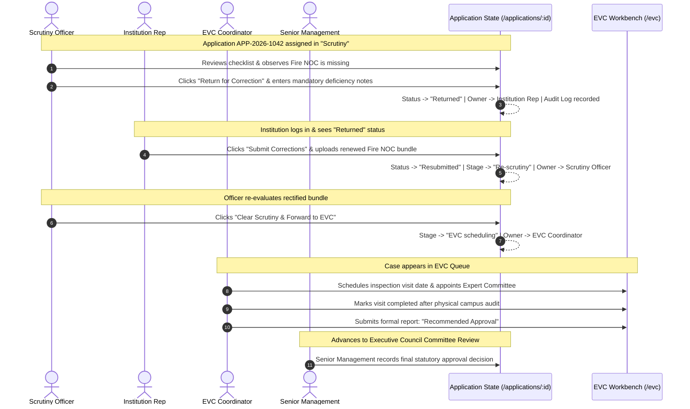
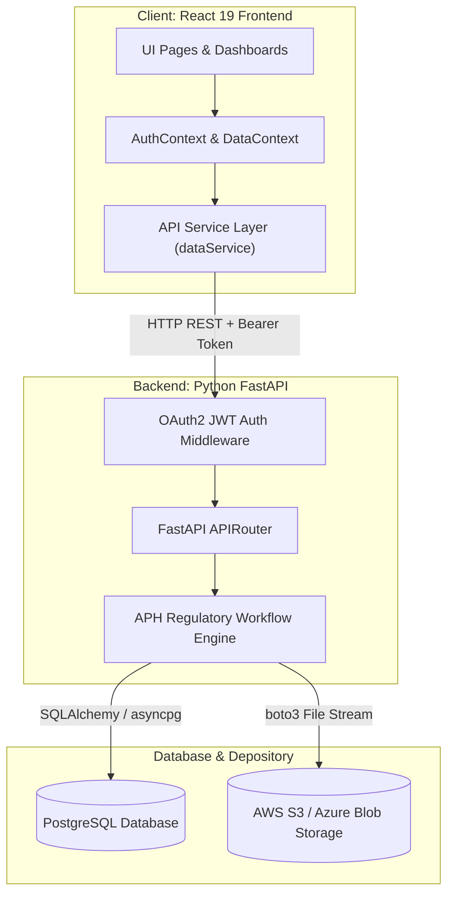

# AICTE Approval & Compliance Orchestration Platform (SIH 26262)
## Complete React Frontend Architecture & Implementation Documentation

> **Document Version:** 1.0.0  
> **Target Audience:** Frontend Developers, Backend Engineers (Python FastAPI), Team Members, and Smart India Hackathon (SIH) Evaluators  
> **Source Base:** `sih26262_front/` (Production-Ready React 19 + Vite Prototype)  
> **Workspace Path:** `c:\Users\alone\OneDrive\Desktop\sih26262_front\`  
> **File Status:** Derived directly from the actual implemented source code.

---

## Table of Contents

1. [Project Introduction](#section-1-project-introduction)
2. [Technology Stack](#section-2-technology-stack)
3. [How to Run the Frontend Locally](#section-3-how-to-run-the-frontend-locally)
4. [Complete Project Folder Structure](#section-4-complete-project-folder-structure)
5. [React Concepts Used in Our Project](#section-5-react-concepts-used-in-our-project)
6. [Complete Routing and Navigation Guide](#section-6-complete-routing-and-navigation-guide)
7. [Complete Button and Interaction Mapping](#section-7-complete-button-and-interaction-mapping)
8. [Seven User Roles and Permissions](#section-8-seven-user-roles-and-permissions)
9. [Detailed Explanation of All Nine Modules](#section-9-detailed-explanation-of-all-nine-modules)
10. [Complete Application Workflow Explanation](#section-10-complete-application-workflow-explanation)
11. [Mock Data and LocalStorage](#section-11-mock-data-and-localstorage)
12. [Backend Integration Guide (FastAPI + PostgreSQL)](#section-12-backend-integration-guide)
13. [API Integration Mapping](#section-13-api-integration-mapping)
14. [Suggested Database Entities](#section-14-suggested-database-entities)
15. [End-to-End Frontend and Backend Architecture](#section-15-end-to-end-frontend-and-backend-architecture)
16. [SIH Live Demonstration Guide (Judge Demo Script)](#section-16-sih-live-demonstration-guide)
17. [SIH Judges Questions and Answers (25 Detailed Q&As)](#section-17-sih-judges-questions-and-answers)
18. [Troubleshooting and Maintenance](#section-18-troubleshooting-and-maintenance)
19. [Current Implementation Status](#section-19-current-implementation-status)
20. [Quick Revision Cheat Sheet](#section-20-quick-revision-cheat-sheet)

---

# SECTION 1: Project Introduction

### 1.1 What SIH 26262 is About
Problem Statement **SIH 26262** addresses the regulatory orchestration challenges faced by the **All India Council for Technical Education (AICTE)**. Every academic year, thousands of technical institutions across India apply for approvals, extensions (Extension of Approval - EoA), new department establishments, program closures, and variation in student intake.

Managing these workflows involves a strict regulatory sequence governed by the AICTE **Approval Process Handbook (APH)**:
1. Documentary Scrutiny by designated Scrutiny Officers.
2. Deficiencies identification and formal return to institutions for rectification.
3. On-site or virtual physical audits conducted by an Expert Visit Committee (EVC).
4. Ongoing monitoring of mandatory post-approval statutory undertakings (Compliance).
5. Expiry tracking of critical legal instruments (registered land leases, fire safety NOCs, building occupancy approvals, fixed deposit receipts).

### 1.2 The Problem Our Frontend Solves
Traditional regulatory platforms suffer from three severe bottlenecks:
- **Fragmented Communication:** Offline back-and-forth between colleges and scrutiny officers leads to lost documentation and untracked SLA delays.
- **Conflation of Submission with Compliance:** In basic CRUD platforms, an institution uploading a PDF often automatically marks the condition as "Compliant", bypassing mandatory human desk scrutiny.
- **Lack of Role Tailoring:** A single generic portal overwhelms different stakeholders with irrelevant controls. A college principal needs to see rectification deadlines, an EVC coordinator needs visit rosters, and a Regional Officer needs regional pendency overviews.

### 1.3 Why This Platform is Needed
Our platform serves as a unified, auditable **workflow orchestration operating system**. It ensures that:
- Every action is strictly governed by **Role-Based Access Control (RBAC)** across 7 distinct roles.
- The system enforces a strict statutory separation: **Evidence Submission $\neq$ Verified Compliance**.
- Scrutiny returns and institutional resubmissions preserve an immutable audit trail and version history.
- Early-warning alerts flag SLA breaches before statutory handbook deadlines elapse.

### 1.4 How the Platform Helps Institutions and AICTE Officials
- **For Technical Institutions:** Transparent tracking of application progress, instant notification of deficiency notices, streamlined rectification upload, and clear visibility into expiring legal certificates.
- **For AICTE Scrutiny Officers & Reviewers:** Systematic checklist evaluation, standardized observation recording, clear division between desk scrutiny and physical EVC visits.
- **For Regional Officers & Senior Management:** Executive dashboards, regional workload analytics, automated SLA breach escalations, and audit-ready reporting.

### 1.5 Implemented Modules vs. Simulated Features
- **Implemented in Active Code:**
  1. Login & Role Switcher (`/login`)
  2. 7 Role-Adaptive Dashboards under `/dashboard`
  3. Application Explorer with 6 working filters (`/applications`)
  4. 7-Tab Application Detail & Scrutiny Workflow (`/applications/:id`)
  5. EVC Workbench with Scheduling & Report Filing (`/evc`)
  6. Compliance & Evidence Review with separate submit vs. verify states (`/compliance`)
  7. Document Registry with browser-memory preview and multi-version renewals (`/documents`)
  8. Alerts & Escalations Center with simulated gateway faults and policy referrals (`/alerts`)
  9. Reports & Analytics Workbench with Recharts charts and CSV export (`/reports`)
- **Simulated for the Prototype:**
  - Authentication sessions use demo profiles stored in `localStorage` rather than server-issued JWT cookies.
  - Uploaded certificate files are stored in temporary browser memory (`URL.createObjectURL(file)`) for live preview rather than AWS S3 or Azure Blob storage.
  - SMS/Email gateway delivery failures and retries are simulated in UI state; no telecom or SMTP traffic is fired.
  - Compliance seals and QR codes are SVG/CSS UI simulations rather than PKI cryptographic signatures.

### 1.6 How the Frontend Communicates with the Future Backend
All data reads and mutations are encapsulated in a centralized service and context layer ([dataService.js](file:///c:/Users/alone/OneDrive/Desktop/sih26262_front/src/services/dataService.js), [DataContext.jsx](file:///c:/Users/alone/OneDrive/Desktop/sih26262_front/src/context/DataContext.jsx)). When the Python FastAPI backend is integrated, these internal functions will be replaced by standard `fetch()` or `axios` HTTP calls without modifying the visual UI components.

### 1.7 Two-Minute Presentation Script (For Judges)
> *"Respected Evaluators, Problem Statement SIH 26262 demands a robust orchestration engine for AICTE's annual approval and statutory compliance cycle. We have engineered a role-adaptive frontend supporting all 7 official stakeholders—from College Principals to Scrutiny Officers, EVC Coordinators, Regional Directors, and the Member Secretary.*
> 
> *Our platform solves the critical flaw of traditional portals: we enforce the statutory rule that Evidence Submission is NOT Verified Compliance. Through our 7-tab application dossier, Scrutiny Officers record observations, return applications for deficiency correction, and colleges resubmit versioned dossiers with full timeline audit logging.*
> 
> *The platform orchestrates physical EVC inspections, tracks expiring 30-year land deeds with version preservation, monitors handbook turnaround SLAs through automated escalations, and provides Senior Management with live Recharts analytics and CSV audit exports. Everything runs on clean, accessible, zero-bloat Plain CSS and React 19, ready for seamless connection to our Python FastAPI and PostgreSQL backend."*

---

# SECTION 2: Technology Stack

Every technology used in this codebase was selected to ensure maximum speed, lightweight bundles, accessibility, and zero unnecessary bloat:

| Technology | Version in Project | Why We Use It | Where It Is Implemented |
| :--- | :--- | :--- | :--- |
| **React.js** | `^19.3.1` | Modern declarative UI component library. Enables reactive state re-rendering when applications transition stages or documents renew. | Core framework throughout `src/`. |
| **Vite** | `^8.3.4` | Next-generation frontend build tool. Provides sub-second Hot Module Replacement (HMR) and optimized Rollup client bundling. | `vite.config.js`, `package.json`. |
| **JavaScript (ES6+)**| Native | Provides modules (`import`/`export`), arrow functions, destructuring, and array methods (`map`, `filter`, `reduce`). | All `.js` and `.jsx` files. |
| **JSX** | Native React Syntax | HTML-like syntax inside JavaScript allowing UI structure and logic to live together cleanly. | All files in `src/components/` and `src/pages/`. |
| **React Router DOM** | `^7.18.4` | Declarative client-side routing. Allows instantaneous navigation between modules without full browser reloads. | `src/routes/AppRouter.jsx`, `ProtectedRoute.jsx`. |
| **Context API** | Native React | Global state management without third-party bloat like Redux. Manages authenticated user session and synced entity collections. | `src/context/AuthContext.jsx`, `src/context/DataContext.jsx`. |
| **Plain Vanilla CSS**| Native CSS3 | Maximum control over layout and styling without Tailwind CSS dependencies. Uses official AICTE Gov color tokens. | `src/index.css`, `src/styles/variables.css`. |
| **Lucide React** | `^1.61.0` | Lightweight, crisp SVG icon library. Visually distinguishes statutory statuses, alerts, and navigation links. | Imported across all pages and common components. |
| **Recharts** | `^3.10.1` | Composable, SVG-based charting library for React. Renders clean, accessible bar and donut charts without 3D animation bloat. | `src/pages/ReportsPage.jsx`, `SeniorManagementDashboard.jsx`. |
| **LocalStorage** | Native Web API | Persistent browser storage engine that allows demo state, workflow transitions, and renewals to persist after page refreshes. | `src/context/DataContext.jsx`, `src/services/dataService.js`. |

### Key Distinctions for Beginners:
- **JavaScript vs. JSX:** JavaScript is the programming language that handles logic. JSX is a syntax extension that looks like HTML (`<div className="panel">`) but gets converted into JavaScript function calls (`React.createElement`) by the Vite compiler.
- **React vs. Vite:** React is the **library** you code in (components, state, props). Vite is the **development server and build tool** that compiles your code, refreshes the browser when you save, and bundles production files.

---

# SECTION 3: How to Run the Frontend Locally

### 3.1 Prerequisites on Windows
1. **Node.js** (v18.0.0 or higher recommended, e.g. Node v20/v22).
2. **npm** (Node Package Manager, installed automatically with Node.js).
3. **Visual Studio Code** or any modern code editor.

### 3.2 Step-by-Step Execution Guide

#### Step 1: Verify Environment
Open PowerShell or Command Prompt and verify that Node.js and npm are installed:
```powershell
node -v
npm -v
```
*Expected output: Something like `v20.18.0` and `10.8.2`.*

#### Step 2: Open Project Folder
```powershell
cd c:\Users\alone\OneDrive\Desktop\sih26262_front
```

#### Step 3: Install Dependencies
Download and install all libraries declared in `package.json`:
```powershell
npm install
```

#### Step 4: Start the Development Server
```powershell
npm run dev
```

#### Step 5: Open in Your Browser
Vite will output the local network URL in your terminal:
```
  VITE v8.3.4  ready in 240 ms

  ➜  Local:   http://localhost:5173/
  ➜  Network: http://127.0.0.1:5173/
```
Click or paste **`http://localhost:5173/`** into Google Chrome, Microsoft Edge, or Firefox.

#### Step 6: Stop the Server
To terminate the local dev server, click inside the terminal window and press:
`Ctrl + C`, then type `Y` and press Enter.

#### Step 7: Production Build & Preview
To test how the application runs in a production environment:
```powershell
npm run build
npm run preview
```

### 3.3 Common Errors & Troubleshooting

| Error | Root Cause | Solution |
| :--- | :--- | :--- |
| `'npm' is not recognized as an internal or external command` | Node.js is not added to the Windows System `PATH` variable. | Re-run Node.js installer and check "Add to PATH", or restart your PowerShell terminal. |
| `Port 5173 is in use` | Another Vite instance is running in the background. | Vite will automatically try `5174`. Or find and terminate the process: `Stop-Process -Id (Get-NetTCPConnection -LocalPort 5173).OwningProcess -Force`. |
| `Blank White Page in Browser` | JavaScript syntax error or missing component export. | Press `F12` to open DevTools, select the **Console** tab, and read the red error stack trace. |
| `Cannot find module 'recharts'` or `'lucide-react'` | Dependencies not installed in `node_modules`. | Run `npm install` again in the project root folder. |

---

# SECTION 4: Complete Project Folder Structure

```
sih26262_front/
├── index.html                               # HTML entry point with viewport & title
├── package.json                             # Dependencies, scripts (dev, build, preview)
├── vite.config.js                           # Vite configuration with React plugin
├── src/
│   ├── main.jsx                             # React DOM root mounting entry point
│   ├── App.jsx                              # Root wrapper uniting AuthProvider & DataProvider
│   ├── index.css                            # Global styles, Gov layout, form inputs, tables
│   ├── styles/
│   │   └── variables.css                    # CSS variables: colors, fonts, shadows, borders
│   ├── routes/
│   │   └── AppRouter.jsx                    # React Router configuration with ProtectedRoute
│   ├── context/
│   │   ├── AuthContext.jsx                  # Demo credentials, active role switcher, session
│   │   └── DataContext.jsx                  # State store for Applications, EVC, Compliance, Docs
│   ├── services/
│   │   ├── authService.js                   # Mock user resolution and role helpers
│   │   └── dataService.js                   # KPI calculations and reactive LocalStorage getters
│   ├── utils/
│   │   └── permissions.js                   # RBAC navigation matrix & route guard logic
│   ├── data/
│   │   ├── mockUsers.js                     # 7 predefined role users (passwords & bios)
│   │   ├── mockInstitutions.js              # Sample institutions across AICTE regions
│   │   ├── mockApplications.js              # Detailed applications with checklists & stages
│   │   ├── mockEVC.js                       # Expert Visit Committee schedules & panels
│   │   ├── mockCompliance.js                # Post-approval conditions & evidence records
│   │   ├── mockDocuments.js                 # Statutory documents (Leases, Fire NOC, FDRs)
│   │   ├── mockAlerts.js                    # SLA warning alerts and escalations
│   │   ├── mockActivity.js                  # System-wide audit log history records
│   │   └── mockAdminData.js                 # Admin workflow versions & role matrix
│   ├── components/
│   │   ├── auth/
│   │   │   └── ProtectedRoute.jsx           # Redirects unauthenticated users to /login
│   │   ├── layout/
│   │   │   ├── DashboardLayout.jsx          # Frame combining Header, Sidebar, & Main area
│   │   │   ├── Header.jsx                   # Sticky top header with role selector & reset
│   │   │   └── Sidebar.jsx                  # Left vertical menu filtered by user role
│   │   └── common/
│   │       ├── KPICard.jsx                  # Reusable KPI metric card with icon & tint
│   │       ├── DataTable.jsx                # Reusable table container
│   │       ├── StatusBadge.jsx              # Color-coded badge for statutory statuses
│   │       ├── DashboardSection.jsx         # Card section wrapper
│   │       ├── DeadlineList.jsx             # Widget listing approaching deadlines
│   │       ├── RecentActivity.jsx           # Widget listing recent audit logs
│   │       ├── TabsNav.jsx                  # Tab selector bar with count badges
│   │       ├── Modal.jsx                    # Accessible modal dialog with backdrop
│   │       └── EmptyState.jsx               # Visual indicator when zero records match
│   └── pages/
│       ├── Login/
│       │   └── LoginPage.jsx                # Portal login with quick role chips
│       ├── ApplicationsPage.jsx             # Applications Explorer table with 6 filters
│       ├── ApplicationDetailPage.jsx         # 7-Tab Dossier with deficiency & clearance modals
│       ├── EVCPage.jsx                      # EVC inspection workbench & report filing
│       ├── CompliancePage.jsx               # Post-approval compliance & evidence review
│       ├── DocumentsPage.jsx                # Document repository, memory preview & renewals
│       ├── AlertsPage.jsx                   # Proactive SLA alerts, failures & escalations
│       ├── ReportsPage.jsx                  # Analytics with Recharts charts & CSV export
│       └── dashboards/
│           ├── DashboardPage.jsx            # Dynamic switcher rendering role's dashboard
│           ├── InstitutionDashboard.jsx      # Role 1: College Representative Dashboard
│           ├── RegionalOfficerDashboard.jsx  # Role 2: Regional Director Dashboard
│           ├── ScrutinyOfficerDashboard.jsx  # Role 3: Scrutiny Officer Dashboard
│           ├── EVCCoordinatorDashboard.jsx   # Role 4: EVC Operations Dashboard
│           ├── ComplianceReviewerDashboard.jsx# Role 5: Compliance Reviewer Dashboard
│           ├── SeniorManagementDashboard.jsx # Role 6: Executive Leadership Dashboard
│           └── AdministratorDashboard.jsx    # Role 7: System Administrator Dashboard
```

---

# SECTION 5: React Concepts Used in Our Project

Here is how fundamental React concepts are used in our actual codebase:

### 1. Components
A component is a reusable function that returns JSX (UI structure).
- **Example from Code ([KPICard.jsx](file:///c:/Users/alone/OneDrive/Desktop/sih26262_front/src/components/common/KPICard.jsx)):**
```jsx
export const KPICard = ({ title, value, subtitle, iconName, tint = 'blue', onClick }) => {
  return (
    <div className={`kpi-card kpi-card-${tint}`} onClick={onClick} style={{ cursor: onClick ? 'pointer' : 'default' }}>
      <div className="kpi-card-header">
        <span className="kpi-card-title">{title}</span>
      </div>
      <div className="kpi-card-value">{value}</div>
      {subtitle && <div className="kpi-card-subtitle">{subtitle}</div>}
    </div>
  );
};
```
*When it executes, it creates a self-contained metric card that we reuse dozens of times across all 7 dashboards.*

### 2. Props (Properties)
Props are custom arguments passed from a parent component into a child component.
- In the `KPICard` above, `title`, `value`, `subtitle`, and `tint` are props. The parent passes `<KPICard title="Overdue Cases" value={4} tint="red" />`, and the child renders those exact values.

### 3. State & `useState`
State is internal memory held by a component. When state updates, React automatically recalculates the UI and re-renders the component.
- **Example from Code ([ApplicationsPage.jsx](file:///c:/Users/alone/OneDrive/Desktop/sih26262_front/src/pages/ApplicationsPage.jsx)):**
```jsx
const [searchQuery, setSearchQuery] = useState('');
const [selectedRegion, setSelectedRegion] = useState('ALL');
const [currentPage, setCurrentPage] = useState(1);
```
*When the user types into the search box, `setSearchQuery(e.target.value)` updates the state, causing the table rows to filter immediately.*

### 4. `useEffect`
`useEffect` tells React to run side effects (like synchronizing data to `localStorage` or fetching data) after the component renders.
- **Example from Code ([DataContext.jsx](file:///c:/Users/alone/OneDrive/Desktop/sih26262_front/src/context/DataContext.jsx)):**
```jsx
useEffect(() => {
  localStorage.setItem('aicte_applications_store', JSON.stringify(applications));
}, [applications]);
```
*Whenever the `applications` state changes (e.g. an application is returned for correction), this hook saves the updated array to browser `localStorage`.*

### 5. Context API
The Context API provides global state accessible by any component in the application without having to pass props through 10 intermediate levels ("prop drilling").
- In our project, [AuthContext.jsx](file:///c:/Users/alone/OneDrive/Desktop/sih26262_front/src/context/AuthContext.jsx) provides `user`, `role`, `login()`, and `logout()`. Any button anywhere can simply call `const { role } = useAuth();`.

### 6. React Router & `useNavigate`
React Router monitors the URL bar and dynamically switches which component is displayed on the screen without triggering a full page reload.
- `useNavigate` allows programmatic navigation (e.g. `navigate('/applications/' + id)` when clicking a row).

### 7. Conditional Rendering
Rendering different elements based on whether a condition is true or false.
- **Example from Code ([ApplicationDetailPage.jsx](file:///c:/Users/alone/OneDrive/Desktop/sih26262_front/src/pages/ApplicationDetailPage.jsx)):**
```jsx
{isScrutinyOfficer && application.status !== 'Returned' && (
  <button onClick={() => setIsReturnModalOpen(true)} className="btn btn-outline">
    Return for Correction
  </button>
)}
```
*The "Return for Correction" button only appears if the logged-in user is a Scrutiny Officer AND the application is not already returned.*

### 8. Forms & Controlled Inputs
An input whose displayed value is bound to React state:
`<input value={searchQuery} onChange={(e) => setSearchQuery(e.target.value)} />`. Every keystroke updates state, keeping the form in sync.

---

# SECTION 6: Complete Routing and Navigation Guide

Every route in the platform is managed by React Router v7 inside [AppRouter.jsx](file:///c:/Users/alone/OneDrive/Desktop/sih26262_front/src/routes/AppRouter.jsx). All application routes (except `/login`) are wrapped inside `<ProtectedRoute>` and `<DashboardLayout>`.

### Route Master Table

| Route | Page Name | Component File | Allowed Roles | Purpose | How Users Navigate There | What Happens on Page Load |
| :--- | :--- | :--- | :--- | :--- | :--- | :--- |
| `/login` | Login & Role Switcher | `LoginPage.jsx` | Public (All) | Authenticate user or click quick-demo role chip | Direct link or Logout button | Loads login form with 7 demo role chips |
| `/dashboard` | Role-Adaptive Dashboard | `DashboardPage.jsx` | All 7 Roles | Role-tailored operational cockpit | Sidebar "Dashboard" link | Inspects `role` from AuthContext and renders 1 of 7 dashboard components |
| `/applications` | Application Explorer | `ApplicationsPage.jsx` | All 7 Roles | Master registry of applications with 6 filters | Sidebar "Applications" link | Loads applications list scoped to user's permissions |
| `/applications/:id` | Application Detail Dossier | `ApplicationDetailPage.jsx` | All 7 Roles | 7-tab application dossier & workflow actions | Click "View" or Application ID in tables | Reads `:id` from URL params, loads dossier, checklist, timeline & submissions |
| `/evc` | EVC Operations Workbench | `EVCPage.jsx` | Regional Officer, EVC Coordinator, Sr Management, Admin | Schedule visits, appoint panels, file reports | Sidebar "EVC Operations" link | Loads 5 KPIs, 5 tabs, and EVC inspection table |
| `/compliance` | Compliance Review Workbench | `CompliancePage.jsx` | Institution Rep, Regional Officer, Compliance Reviewer, Sr Mgmt, Admin | Track conditions, submit evidence, evaluate compliance | Sidebar "Compliance Review" link | Scopes obligations (colleges see own; reviewers see all); renders 6 tabs |
| `/documents` | Document Registry & Renewal | `DocumentsPage.jsx` | Institution Rep, Regional Officer, Scrutiny Officer, Compliance Reviewer, Sr Mgmt, Admin | Repository of legal deeds, NOCs, versioned renewals | Sidebar "Document Registry" link | Calculates expiry dates; renders 5 KPIs; provides browser-memory preview |
| `/alerts` | Alerts & Escalations Center | `AlertsPage.jsx` | Regional Officer, Scrutiny Officer, EVC Coordinator, Compliance Reviewer, Sr Mgmt, Admin | Proactive SLA breach tracking & policy escalations | Sidebar "Alerts & Escalations" link | Loads alerts; highlights unread items; enables acknowledge & escalation |
| `/reports` | Reports & Analytics | `ReportsPage.jsx` | Regional Officer, Senior Management, Administrator | Recharts visualizers, pendency trends, CSV export | Sidebar "Reports & Analytics" link | Calculates dynamic chart distributions from active filters |
| `*` | Catch-All Redirect | Redirect | All | Fallback for unknown URLs | Invalid URL entry | Automatically redirects browser to `/dashboard` |

### How React Router Prevents Page Reloads:
When a user clicks `<Link to="/applications">`, React Router intercepts the browser's default link behavior (`e.preventDefault()`), modifies the browser's History API (`pushState`), and replaces the active view in the DOM in under 5 milliseconds. The page never flickers or reloads scripts.

---

# SECTION 7: Complete Button and Interaction Mapping

This table documents **every functional button and action** implemented in the frontend.

| Page / Component | Button / Control Label | Who Can Use It | What Happens on Click | Destination / Action | Function Called | Data Changed | Future Backend API |
| :--- | :--- | :--- | :--- | :--- | :--- | :--- | :--- |
| **Login** | Role Chips (7 buttons) | Anyone | Auto-fills demo credentials | Stays on `/login` | `handleQuickRoleSelect(role)` | Local form state | N/A (Frontend demo helper) |
| **Login** | "Sign In to Portal" | Anyone | Authenticates and sets session | Navigates to `/dashboard` | `handleSubmit(e)` | `user`, `role` in AuthContext & localStorage | `POST /api/v1/auth/token` |
| **Header** | "Active Role" Dropdown | Anyone | Switches logged-in role instantly | Re-renders current view | `switchRole(newRole)` | `role`, `user` in AuthContext & localStorage | `POST /api/v1/auth/switch-role` |
| **Header** | "Reset Demo Data" | Anyone | Restores pristine mock data | Refreshes window | `resetToInitialData()` | Clears & re-populates all 6 `aicte_*` localStorage stores | `POST /api/v1/system/reset-demo` |
| **Header** | "Logout" | Anyone | Clears session and logs out | Navigates to `/login` | `logout()` | `user=null`, `role=null` in AuthContext & localStorage | `POST /api/v1/auth/logout` |
| **Sidebar** | Module Links (7 links) | Role-authorized | Navigates to selected module | Specific route | React Router `<NavLink>` | None (Routing only) | N/A |
| **Applications** | "Search by ID or College" | All Roles | Filters rows by text query | Stays on table | `setSearchQuery(e.target.value)` | Local UI state | `GET /api/v1/applications?q=...` |
| **Applications** | 5 Dropdown Filters | All Roles | Filters by Region, Stage, Type, Status, Officer | Stays on table | `setSelected*(e.target.value)` | Local UI state | `GET /api/v1/applications?region=...` |
| **Applications** | "Sort by Deadline" | All Roles | Toggles deadline ascending/descending | Stays on table | `setSortOrder(...)` | Local UI state | `GET /api/v1/applications?sort=deadline` |
| **Applications** | "Reset Filters" | All Roles | Clears all 6 filters to defaults | Stays on table | `handleResetFilters()` | Local UI state | N/A |
| **Applications** | "Previous" / "Next" | All Roles | Changes active page | Stays on table | `setCurrentPage(prev => ...)` | Local UI state | `GET /api/v1/applications?page=2` |
| **Applications** | "View" (in table row) | All Roles | Opens detailed application dossier | Navigates to `/applications/:id` | `<Link to={...}>` | None (Routing only) | `GET /api/v1/applications/{id}` |
| **App Detail** | 7 Tabs (Overview..Audit) | All Roles | Switches displayed tab content | Stays on page | `setActiveTab(tabKey)` | Local UI state | N/A |
| **App Detail** | "Return for Correction" | Scrutiny Officer, Regional Officer | Opens modal for deficiency reasons | Opens Return Modal | `setIsReturnModalOpen(true)` | Local UI state | N/A |
| **App Detail** | "Confirm Return for Correction" | Scrutiny Officer, Regional Officer | Returns app; updates owner to Institution | Stays on page | `performWorkflowAction('RETURN_FOR_CORRECTION', ...)` | `status='Returned'`, owner='Institution Rep', appends timeline & audit | `POST /api/v1/applications/{id}/return` |
| **App Detail** | "Submit Corrections" | Institution Rep | Opens modal to upload rectifications | Opens Resubmit Modal | `setIsResubmitModalOpen(true)` | Local UI state | N/A |
| **App Detail** | "Confirm Resubmission" | Institution Rep | Resubmits dossier; returns owner to Scrutiny | Stays on page | `performWorkflowAction('SUBMIT_CORRECTIONS', ...)` | `status='Resubmitted'`, `currentStage='Re-scrutiny'`, appends submission & audit | `POST /api/v1/applications/{id}/resubmit` |
| **App Detail** | "Clear Scrutiny & Forward" | Scrutiny Officer | Clears scrutiny; advances to EVC | Opens Clearance Modal | `setIsClearModalOpen(true)` | Local UI state | N/A |
| **App Detail** | "Confirm Clearance to EVC" | Scrutiny Officer | Advances stage to EVC scheduling | Stays on page | `performWorkflowAction('COMPLETE_SCRUTINY', ...)` | `currentStage='EVC scheduling'`, `owner='C. Verma (EVC)'`, appends timeline & audit | `POST /api/v1/applications/{id}/clear-scrutiny` |
| **App Detail** | "Save Observation" | Scrutiny Officer | Records checklist evaluation notes | Stays on page | `handleSaveObservations()` | Updates `observations` in application & activity store | `PUT /api/v1/applications/{id}/observations` |
| **EVC** | 5 Tab Navigation | EVC Roles | Filters cases by scheduling/completion | Stays on page | `setActiveTab(tab)` | Local UI state | `GET /api/v1/evc?status=...` |
| **EVC** | "Schedule Visit" | EVC Coordinator, Regional Officer | Opens modal to pick date & panel | Opens Schedule Modal | `handleOpenScheduleModal(row)` | Local UI state | N/A |
| **EVC** | "Confirm Schedule" | EVC Coordinator, Regional Officer | Locks visit date & committee roster | Stays on page | `scheduleEVC(...)` | `status='Scheduled'`, `visitDate`, appends activity | `POST /api/v1/evc/{id}/schedule` |
| **EVC** | "Mark Completed" | EVC Coordinator, Regional Officer | Records conclusion of physical audit | Stays on page | `markEVCCompleted(...)` | `status='Visit completed'`, appends activity | `POST /api/v1/evc/{id}/complete` |
| **EVC** | "Submit Report" | EVC Coordinator, Regional Officer | Opens modal for EVC recommendations | Opens Report Modal | `setIsReportModalOpen(true)` | Local UI state | N/A |
| **EVC** | "Save EVC Report" | EVC Coordinator, Regional Officer | Records EVC approval recommendation | Stays on page | `submitEVCReport(...)` | `status='Complete for stage'`, `recommendation`, appends activity | `POST /api/v1/evc/{id}/report` |
| **EVC** | "View Details" | All Authorized | Opens read-only committee roster | Opens Details Modal | `setSelectedEVC(row)` | Local UI state | `GET /api/v1/evc/{id}` |
| **Compliance** | 6 Tab Navigation | Compliance Roles | Filters by Due Soon, Overdue, Verified | Stays on page | `setActiveTab(tab)` | Local UI state | `GET /api/v1/compliance?status=...` |
| **Compliance** | "Submit Evidence" / "Resubmit Proof" | Institution Rep | Opens modal to attach proof file | Opens Evidence Modal | `handleOpenSubmitModal(row)` | Local UI state | N/A |
| **Compliance** | "Confirm Evidence Submission" | Institution Rep | Files proof; sets status to Evidence submitted | Stays on page | `submitComplianceEvidence(...)` | `status='Evidence submitted'`, `evidenceFile`, appends activity | `POST /api/v1/compliance/{id}/evidence` |
| **Compliance** | "Initiate Review" | Compliance Reviewer | Starts desk evaluation | Stays on page | `handleMarkUnderVerification(...)` | `status='Verification pending'`, appends activity | `POST /api/v1/compliance/{id}/initiate` |
| **Compliance** | "Evaluate Evidence" | Compliance Reviewer | Opens modal to record compliance decision | Opens Review Modal | `handleOpenReviewModal(row)` | Local UI state | N/A |
| **Compliance** | "Record Decision" | Compliance Reviewer | Sets Verified compliant or Clarification requested | Stays on page | `verifyComplianceEvidence(...)` | `status='Verified compliant'`, `remarks`, appends activity | `POST /api/v1/compliance/{id}/verify` |
| **Documents** | "Upload Document" | All Authorized | Opens registration modal | Opens Upload Modal | `handleOpenUploadModal()` | Local UI state | N/A |
| **Documents** | "Register & Submit Document" | All Authorized | Validates dates; holds file in browser memory | Stays on page | `uploadDocument(...)` | Adds document to store, `versions=[v1.0]`, appends activity | `POST /api/v1/documents/upload` |
| **Documents** | "View" | All Authorized | Opens viewer with Overview & Version History | Opens Details Modal | `handleOpenDetailsModal(row)` | Local UI state | `GET /api/v1/documents/{id}` |
| **Documents** | "Renew" | All Authorized | Opens renewal modal for new expiry date | Opens Renewal Modal | `handleOpenRenewalModal(row)` | Local UI state | N/A |
| **Documents** | "Submit Renewal Version" | All Authorized | Increments version (v2.0); stores history | Stays on page | `submitDocumentRenewal(...)` | `currentVersion='v2.0'`, `status='Renewal submitted'`, appends version & audit | `POST /api/v1/documents/{id}/renew` |
| **Documents** | "Verify" | Compliance Reviewer, Regional Officer | Opens modal to verify legal seal | Opens Verify Modal | `handleOpenVerifyModal(row)` | Local UI state | N/A |
| **Documents** | "Record Verification" | Compliance Reviewer, Regional Officer | Sets status to Verified or Expired | Stays on page | `updateDocumentVerification(...)` | `verificationStatus='Verified'`, appends activity | `PATCH /api/v1/documents/{id}/verify` |
| **Alerts** | 7 Tab Navigation | All Authorized | Filters alerts by deadline, EVC, escalations | Stays on page | `setActiveTab(tab)` | Local UI state | `GET /api/v1/alerts?category=...` |
| **Alerts** | "Mark as Read" (Eye icon) | All Authorized | Marks unread dot as read | Stays on page | `handleMarkRead(id)` | `read=true` in alerts store | `PATCH /api/v1/alerts/{id}/read` |
| **Alerts** | "Acknowledge" | All Authorized | Records officer acknowledgement timestamp | Stays on page | `handleAcknowledge(id)` | `acknowledged=true`, `acknowledgedAt`, `deliveryStatus='Acknowledged'`, appends audit | `POST /api/v1/alerts/{id}/acknowledge` |
| **Alerts** | "Open" | All Authorized | Navigates to linked dossier | Opens linked route | `<Link to={getRecordLink(...)}>` | None (Routing only) | N/A |
| **Alerts** | "Fail" (Demo helper) | All Authorized | Simulates SMS/Email delivery timeout | Stays on page | `handleSimulateFailure(id)` | `deliveryStatus='Delivery failed'` in alerts store | N/A (Simulation helper) |
| **Alerts** | "Retry" | All Authorized | Re-dispatches failed notification | Stays on page | `handleRetryNotification(id)` | `deliveryStatus='Delivery confirmed'` in alerts store | `POST /api/v1/alerts/{id}/retry` |
| **Alerts** | "Escalate" | All Authorized | Opens modal for Senior Management referral | Opens Escalate Modal | `handleOpenEscalateModal(row)` | Local UI state | N/A |
| **Alerts** | "Confirm Escalation" | All Authorized | Escalates alert to Senior Management | Stays on page | `simulateEscalation(...)` | `deliveryStatus='Escalated'`, `urgency='Escalated'`, `recipient='Prof. Adhikari'`, appends audit | `POST /api/v1/alerts/{id}/escalate` |
| **Alerts** | "Sync System Alerts" | All Authorized | Scans database for expiries & generates alerts | Stays on page | `handleGenerateSystemAlerts()` | Generates new dynamic alerts in alerts store | `POST /api/v1/alerts/sync` |
| **Reports** | "Export Filtered CSV" | Regional Officer, Sr Mgmt, Admin | Generates and downloads RFC-compliant CSV | Triggers browser download | `handleExportCSV()` | None (Generates file stream) | `GET /api/v1/reports/export.csv` |
| **Reports** | "Reset Filters" | Regional Officer, Sr Mgmt, Admin | Resets Date, Region, and Type filters | Stays on page | `handleResetFilters()` | Local UI state | N/A |

---

# SECTION 8: Seven User Roles and Permissions

The platform implements a comprehensive **Role-Based Access Control (RBAC)** architecture. In the frontend prototype, the active role is stored in `AuthContext` and persisted in `localStorage` under `aicte_auth_user`.

### 8.1 Role Permission Matrix

| Role Name | Dashboard Route | Permitted Navigation Items | Scoped Data Visibility | Core Authorizations |
| :--- | :--- | :--- | :--- | :--- |
| **1. Institution Representative** | `/dashboard` (College view) | Dashboard, Applications, Compliance, Documents | Strictly own college (`INST-1025` - ABC Institute) | View own applications; submit deficiency responses; upload documents; submit compliance evidence; file renewals. |
| **2. Regional Officer** | `/dashboard` (Regional view) | All 7 Navigation Items | Regional jurisdiction (`Northern Region`) | Issue deficiency returns; reassign officers; approve committee schedules; view regional escalations. |
| **3. Scrutiny Officer** | `/dashboard` (Scrutiny view) | Dashboard, Applications, Alerts | Assigned dossiers & scrutiny queue | Evaluate checklist items; record deficiency observations; return for correction; clear scrutiny to EVC. |
| **4. EVC Coordinator** | `/dashboard` (EVC view) | Dashboard, EVC Operations, Alerts | EVC inspection cases & roster queue | Schedule inspection visits; appoint expert committee panels; mark visits completed; file inspection reports. |
| **5. Compliance Reviewer** | `/dashboard` (Reviewer view) | Dashboard, Compliance, Documents, Alerts | Post-approval undertakings & document registry | Scrutinize evidence proofs; mark under verification; record compliance decisions; certify renewals. |
| **6. Senior Management** | `/dashboard` (Executive view) | All 7 Navigation Items | National Scope (All India Overview) | Executive decision recording; approve committee recommendations; resolve critical policy escalations. |
| **7. Administrator** | `/dashboard` (Admin view) | All 7 Navigation Items | Full System Access | User role assignments; workflow versioning; retry notification failures; reset demo data. |

### 8.2 Role Switching & Protected Routes
- **Session Persistence:** When a user logs in or switches roles using the top-right header selector, `AuthContext` writes `{ id, name, role, email, institutionId, region }` into `localStorage.setItem('aicte_auth_user', ...)`.
- **Route Guarding:** [ProtectedRoute.jsx](file:///c:/Users/alone/OneDrive/Desktop/sih26262_front/src/components/auth/ProtectedRoute.jsx) checks if `user` exists. If not, it saves the attempted URL and redirects to `/login`.
- **Navigation Filtering:** [Sidebar.jsx](file:///c:/Users/alone/OneDrive/Desktop/sih26262_front/src/components/layout/Sidebar.jsx) calls `getNavItemsForRole(role)` from [permissions.js](file:///c:/Users/alone/OneDrive/Desktop/sih26262_front/src/utils/permissions.js). Modules forbidden to that role simply do not render in the sidebar.
- **Backend Responsibility Reminder:** Frontend role checks control UI layout and button visibility. **Real regulatory authorization must always be enforced server-side** in FastAPI using JWT scopes and database row-level security.

---

# SECTION 9: Detailed Explanation of All Nine Modules

### Module 1: Login & Role Switcher (`/login`)
- **Purpose:** Gateway for user authentication and evaluator demonstration.
- **Key Features:**
  - Standard email and password form.
  - Role dropdown selector supporting all 7 official roles.
  - 7 one-click quick access demo chips that auto-populate valid credentials.
  - Form validation requiring all fields.

### Module 2: Role-Adaptive Dashboards (`/dashboard`)
- **Purpose:** Provides a customized executive cockpit for the logged-in role under a single route.
- **Key Features:**
  - Dynamic KPI cards displaying counts calculated live from the shared database.
  - Action cards and quick navigation buttons.
  - Approaching handbook deadline alerts.
  - Live activity audit log widget.
  - Senior Management dashboard features live Recharts visualizers for stage pendency and compliance rates.

### Module 3: Application Explorer (`/applications`)
- **Purpose:** Searchable, filterable database of technical institution approval applications.
- **Key Features:**
  - Real-time text search by Application ID or Institution Name.
  - 5 dropdown filters: Region, Workflow Stage, Application Type, Overdue Status, Assigned Officer.
  - Sort by deadline (ascending/descending).
  - Client-side pagination (8 dossiers per page).
  - Role-scoped data visibility (Colleges only see their own applications; Regional Officers see their region).

### Module 4: Application Details & Workflow Dossier (`/applications/:id`)
- **Purpose:** Complete multi-tab digital dossier governing scrutiny, deficiency notices, and committee forwarding.
- **Seven Tabs:**
  1. *Overview:* Institution details, application category, current stage, assigned officer, next action callout.
  2. *Workflow Timeline:* Visual step-by-step audit progression with timestamps and actors.
  3. *Scrutiny & Observations:* Interactive checklist (Land, Building, Faculty cadre, Fire NOC), observation input, and "Return for Correction" / "Clear Scrutiny" action buttons.
  4. *Submissions:* Versioned filing history (`v1.0` initial filing, `v2.0` deficiency response).
  5. *EVC Inspection:* Committee panel details, visit dates, and inspection findings.
  6. *Compliance Undertakings:* Post-approval statutory conditions linked to this application.
  7. *Audit History:* Permanent immutable timestamp log of every state transition.

### Module 5: EVC Workbench (`/evc`)
- **Purpose:** Manages the constitution, scheduling, and evaluation of Expert Visit Committees.
- **Key Features:**
  - 5 KPI cards: Total EVC Cases, Pending Scheduling, Upcoming Visits, Completed Visits, Reports Pending.
  - 5 Filter Tabs: EVC Queue, Scheduled Visits, Upcoming Visits, Completed Visits, Reports Pending.
  - Schedule Visit Modal: Validates visit dates, assigns coordinators, and names expert panel chairs.
  - Mark Completed: Records physical audit conclusion.
  - Submit Report Modal: Files formal committee findings (`Recommended Approval`, `Deficiencies Found`, `Conditional Approval`).

### Module 6: Compliance & Evidence Review (`/compliance`)
- **Purpose:** Tracks mandatory conditions imposed on institutions post-approval.
- **Key Features:**
  - 6 KPI cards: Total Obligations, Due Soon, Overdue, Evidence Submitted, Under Verification, Completed.
  - 6 Filter Tabs: Due Soon, Overdue, Submitted, Under Verification, Clarification Required, Completed.
  - **Statutory Separation Enforced:** College uploading proof sets status strictly to `Evidence submitted`. It **never** auto-completes.
  - Reviewer desk scrutiny: Reviewer clicks "Initiate Review" (`Verification pending`), evaluates proof, and formally enters `Verified compliant` or `Clarification requested`.

### Module 7: Document Registry & Statutory Renewals (`/documents`)
- **Purpose:** Permanent depository for legal instruments (land lease deeds, fire NOCs, building occupancy, FDR security deposits).
- **Key Features:**
  - 5 KPI cards: Total Documents, Verified Documents, Expiring Soon, Expired Documents, Pending Verification.
  - Upload Document Modal: Date validation ($\text{Issue Date} \le \text{Expiry Date}$) with file held in temporary browser memory.
  - Document Viewer: Live preview iframe for uploaded files, or simulated AICTE official sealed statutory certificate.
  - Version History Tab: Preserves previous certified certificates (`v1.0`, `v2.0`) without overwriting old records.
  - Renewal Workflow: Colleges submit renewed certificates; reviewers certify validity.

### Module 8: Alerts & Escalations Center (`/alerts`)
- **Purpose:** Early-warning SLA monitoring system preventing handbook timeline breaches.
- **Key Features:**
  - 5 KPI cards: Total Alerts, Unread Alerts, Overdue Alerts, Escalated Cases, Failed Notifications.
  - 7 Categorized Tabs: All Alerts, Upcoming Deadlines, Overdue Tasks, EVC Reminders, Compliance Alerts, Document Expiry, Escalations.
  - Officer Acknowledgement: Records receipt timestamp in the audit trail without prematurely closing the underlying task.
  - Simulated Failure & Retry: Simulates gateway delivery failures and retry dispatches.
  - Policy Escalations: Escalates delinquent cases directly to Senior Management (`Prof. H. R. Adhikari`).
  - System Alert Sync: Scans database for expiries and overdue obligations to dynamically generate demo alerts.

### Module 9: Reports & Analytics Workbench (`/reports`)
- **Purpose:** Executive analytics engine providing real-time pendency and workload intelligence.
- **Key Features:**
  - 6 Dynamic KPI cards calculated from active filters.
  - Multi-Filter Toolbar: Date Range, Regional Directorate, Application Type, and Reset button.
  - 7 Visual & Tabular Sections:
    1. Stage-wise Pendency (Bar Chart)
    2. Application Ageing Bands (Bar Chart)
    3. Regional Workload Distribution (Bar Chart)
    4. EVC Inspection Pipeline (Bar Chart)
    5. Statutory Compliance Status (Donut Pie Chart)
    6. Document Expiry Summary Table (with link to `/documents`)
    7. Critical Escalations Table (with link to `/alerts`)
  - **CSV Audit Export:** Generates an RFC-compliant CSV file timestamped `AICTE_Approval_Analytics_Report_YYYY-MM-DD.csv` based on filtered records.

---

# SECTION 10: Complete Application Workflow Explanation

### Step-by-Step Scrutiny & Approval Lifecycle

The following walkthrough illustrates the exact sequence implemented in the platform:



### State Transition Data Changes:
1. **Return for Correction (`RETURN_FOR_CORRECTION`):**
   - `targetApp.status` changes from `'In progress'` to `'Returned'`.
   - `targetApp.owner` reassigns to `'Institution Representative'`.
   - `targetApp.deficiencies` populated with entered deficiency array.
   - Appends entry to `targetApp.timeline` and global `activity` store.
2. **Institution Resubmission (`SUBMIT_CORRECTIONS`):**
   - `targetApp.status` changes to `'Resubmitted'`.
   - `targetApp.currentStage` updates to `'Re-scrutiny'`.
   - `targetApp.owner` reassigns to `'B. Singh (Scrutiny Officer)'`.
   - Appends new `v2.0` dossier entry to `targetApp.submissions`.
3. **Scrutiny Clearance (`COMPLETE_SCRUTINY`):**
   - `targetApp.currentStage` updates to `'EVC scheduling'`.
   - `targetApp.status` changes to `'In progress'`.
   - `targetApp.owner` reassigns to `'C. Verma (EVC Coordinator)'`.

---

# SECTION 11: Mock Data and LocalStorage

### 11.1 Mock Data Organization
Initial canonical records are stored in `src/data/`:
- [mockUsers.js](file:///c:/Users/alone/OneDrive/Desktop/sih26262_front/src/data/mockUsers.js): 7 officer profiles with credentials, roles, and regions.
- [mockInstitutions.js](file:///c:/Users/alone/OneDrive/Desktop/sih26262_front/src/data/mockInstitutions.js): Technical colleges (`INST-1025`, `INST-1044`, `INST-1209`, etc.).
- [mockApplications.js](file:///c:/Users/alone/OneDrive/Desktop/sih26262_front/src/data/mockApplications.js): Applications (`APP-2026-1042`, `APP-2026-0988`, etc.).
- [mockEVC.js](file:///c:/Users/alone/OneDrive/Desktop/sih26262_front/src/data/mockEVC.js): Inspection cases (`EVC-204`, `EVC-195`, etc.).
- [mockCompliance.js](file:///c:/Users/alone/OneDrive/Desktop/sih26262_front/src/data/mockCompliance.js): Post-approval obligations (`OBL-501`, `OBL-502`, etc.).
- [mockDocuments.js](file:///c:/Users/alone/OneDrive/Desktop/sih26262_front/src/data/mockDocuments.js): Statutory deeds (`DOC-305`, `DOC-302`, etc.).
- [mockAlerts.js](file:///c:/Users/alone/OneDrive/Desktop/sih26262_front/src/data/mockAlerts.js): SLA warnings (`ALT-902`, `ALT-896`, etc.).
- [mockActivity.js](file:///c:/Users/alone/OneDrive/Desktop/sih26262_front/src/data/mockActivity.js): System audit trail logs.

### 11.2 LocalStorage Storage Keys
When the application runs, [DataContext.jsx](file:///c:/Users/alone/OneDrive/Desktop/sih26262_front/src/context/DataContext.jsx) loads from browser `localStorage`. If keys are empty, it loads initial mock data:
- `aicte_auth_user`: Active logged-in session object.
- `aicte_applications_store`: JSON array of all application dossiers.
- `aicte_evc_store`: JSON array of EVC inspection cases.
- `aicte_compliance_store`: JSON array of compliance conditions.
- `aicte_documents_store`: JSON array of statutory documents and versions.
- `aicte_alerts_store`: JSON array of notifications and escalations.
- `aicte_activity_store`: JSON array of audit log entries.

### 11.3 Resetting Demo Data
Evaluators can click **Reset Demo Data** in the top header at any point. This clears all 7 keys from `localStorage` and reloads the pristine mock dataset.

### 11.4 Limitations of LocalStorage
- **Storage Cap:** `localStorage` is limited to ~5MB per domain.
- **Browser Isolation:** Data is local to that specific browser instance; other machines or incognito tabs will not see changes.
- **Binary Limitations:** PDF binary files cannot be safely persisted long-term; they must be migrated to PostgreSQL and cloud object storage.

---

# SECTION 12: Backend Integration Guide

*(Dedicated guide for the Python FastAPI & PostgreSQL Backend Developer)*

### 12.1 Authentication Endpoints
#### `POST /api/v1/auth/token`
- **Purpose:** Exchange login credentials for a signed JWT access token.
- **Request Body (JSON):**
  ```json
  {
    "username": "institution_rep",
    "password": "password123",
    "role": "Institution Representative"
  }
  ```
- **Response (200 OK):**
  ```json
  {
    "access_token": "eyJhbGciOiJIUzI1NiIsIn...",
    "token_type": "bearer",
    "user": {
      "id": "USR-INST-01",
      "name": "Dr. R. K. Sharma",
      "role": "Institution Representative",
      "institutionId": "INST-1025",
      "region": "Northern Region"
    }
  }
  ```

---

### 12.2 Applications & Scrutiny Endpoints
#### `GET /api/v1/applications`
- **Query Params:** `?page=1&limit=8&q=ABC&region=Northern+Region&stage=Scrutiny&status=In+progress`
- **Response (200 OK):**
  ```json
  {
    "total": 14,
    "page": 1,
    "limit": 8,
    "items": [
      {
        "id": "APP-2026-1042",
        "institutionId": "INST-1025",
        "institutionName": "ABC Institute of Technology",
        "applicationType": "Extension of Approval / Compliance Review",
        "region": "Northern Region",
        "currentStage": "Scrutiny",
        "owner": "B. Singh (Scrutiny Officer)",
        "deadline": "2026-10-24",
        "submissionDate": "2026-10-20",
        "ageingDays": 4,
        "status": "In progress"
      }
    ]
  }
  ```

#### `POST /api/v1/applications/{id}/actions`
- **Purpose:** Executes state transitions (`RETURN_FOR_CORRECTION`, `SUBMIT_CORRECTIONS`, `COMPLETE_SCRUTINY`).
- **Request Body (JSON):**
  ```json
  {
    "actionType": "RETURN_FOR_CORRECTION",
    "reason": "Fire safety NOC expired; faculty ratio non-compliant.",
    "deficiencies": [
      "Faculty-to-student cadre ratio is non-compliant in Computer Engineering.",
      "Municipal fire safety NOC expired on 30 Sep 2026."
    ],
    "observations": "Checklist evaluated; returned for rectification."
  }
  ```
- **Response (200 OK):** Returns the updated application object with appended timeline and audit log entry.

---

### 12.3 EVC Workbench Endpoints
#### `POST /api/v1/evc/{id}/schedule`
- **Request Body (JSON):**
  ```json
  {
    "visitDate": "2026-10-28",
    "inspectionType": "Physical On-Site Verification",
    "coordinator": "C. Verma (EVC Operations)",
    "experts": [
      "Prof. K. Raman (IIT Roorkee - Chair)",
      "Dr. Sunita Rao (NIT Kurukshetra)"
    ]
  }
  ```

#### `POST /api/v1/evc/{id}/report`
- **Request Body (JSON):**
  ```json
  {
    "outcome": "Recommended Approval",
    "reportNotes": "Physical campus inspection verified adequate laboratory carpet area and faculty rosters."
  }
  ```

---

### 12.4 Compliance & Evidence Endpoints
#### `POST /api/v1/compliance/{id}/evidence`
- **Purpose:** Institution uploads proof for an obligation condition.
- **Request (Multipart/Form-Data):**
  - `file`: `[binary PDF]`
  - `notes`: `"Affidavit and receipt of equipment purchase attached."`
- **Response (200 OK):**
  ```json
  {
    "id": "OBL-501",
    "status": "Evidence submitted",
    "evidenceFile": "OBL-501_affidavit.pdf",
    "submittedDate": "2026-10-23"
  }
  ```

#### `POST /api/v1/compliance/{id}/verify`
- **Purpose:** Reviewer records official verification decision.
- **Request Body (JSON):**
  ```json
  {
    "outcome": "Verified compliant",
    "remarks": "Audited against APH 2026 norms. Equipment serial numbers confirmed."
  }
  ```

---

### 12.5 Document Registry Endpoints
#### `POST /api/v1/documents/upload`
- **Request (Multipart/Form-Data):** `file`, `documentType`, `issueDate`, `expiryDate`, `notes`.
- **Response (201 Created):** Creates document record with `v1.0` in versions table.

#### `POST /api/v1/documents/{id}/renew`
- **Purpose:** Submits renewed endorsement; increments version to `v2.0` without overwriting `v1.0`.
- **Request (Multipart/Form-Data):** `file`, `newIssueDate`, `newExpiryDate`, `notes`.

---

# SECTION 13: API Integration Mapping

| Frontend File | Current Function | Current Mock Source | Future API Endpoint | HTTP Method | Expected Response Payload | Priority |
| :--- | :--- | :--- | :--- | :--- | :--- | :--- |
| `AuthContext.jsx` | `login()` | `mockUsers.js` | `/api/v1/auth/token` | `POST` | `{ access_token, user }` | **High** |
| `ApplicationsPage.jsx` | `useData().applications` | `aicte_applications_store` | `/api/v1/applications` | `GET` | `{ total, items: [...] }` | **High** |
| `ApplicationDetailPage.jsx` | `performWorkflowAction()` | `DataContext.jsx` | `/api/v1/applications/{id}/actions` | `POST` | Updated application dossier | **High** |
| `EVCPage.jsx` | `scheduleEVC()` | `aicte_evc_store` | `/api/v1/evc/{id}/schedule` | `POST` | Updated EVC case | **Medium** |
| `EVCPage.jsx` | `submitEVCReport()` | `aicte_evc_store` | `/api/v1/evc/{id}/report` | `POST` | Updated EVC case | **Medium** |
| `CompliancePage.jsx` | `submitComplianceEvidence()`| `aicte_compliance_store`| `/api/v1/compliance/{id}/evidence`| `POST` | Updated obligation record | **High** |
| `CompliancePage.jsx` | `verifyComplianceEvidence()`| `aicte_compliance_store`| `/api/v1/compliance/{id}/verify` | `POST` | Updated obligation record | **High** |
| `DocumentsPage.jsx` | `submitDocumentRenewal()` | `aicte_documents_store` | `/api/v1/documents/{id}/renew` | `POST` | Updated document with new version | **Medium** |
| `AlertsPage.jsx` | `acknowledgeAlert()` | `aicte_alerts_store` | `/api/v1/alerts/{id}/acknowledge`| `POST` | Updated alert record | **Medium** |
| `ReportsPage.jsx` | `handleExportCSV()` | Filtered state | `/api/v1/reports/export.csv` | `GET` | Raw CSV stream | **Low** |

### Recommended Frontend API Client Configuration:
Create `src/services/apiClient.js`:
```javascript
const API_BASE_URL = import.meta.env.VITE_API_BASE_URL || 'http://localhost:8000/api/v1';

export const apiClient = async (endpoint, options = {}) => {
  const token = localStorage.getItem('aicte_jwt_token');
  const headers = {
    'Content-Type': 'application/json',
    ...(token ? { Authorization: `Bearer ${token}` } : {}),
    ...options.headers,
  };

  const response = await fetch(`${API_BASE_URL}${endpoint}`, { ...options, headers });
  if (response.status === 401) {
    localStorage.removeItem('aicte_jwt_token');
    window.location.href = '/login';
    throw new Error('Session expired');
  }
  return response.json();
};
```

---

# SECTION 14: Suggested Database Entities (PostgreSQL Schema)

For the FastAPI backend developer, the following relational schema reflects the frontend data contracts:

```
  ┌────────────────┐       ┌────────────────┐       ┌────────────────────┐
  │  institutions  │1     *│  applications  │1     *│  workflow_timeline │
  ├────────────────┤───────├────────────────┤───────├────────────────────┤
  │ id (PK)        │       │ id (PK)        │       │ id (PK)            │
  │ name           │       │ institution_id │       │ application_id(FK) │
  │ code           │       │ current_stage  │       │ stage_name         │
  │ region         │       │ status         │       │ actor_name         │
  └────────────────┘       │ owner_id       │       │ timestamp          │
          │1               │ deadline       │       └────────────────────┘
          │                └────────────────┘
          │                        │1
          │                        │*
          │                ┌────────────────┐
          │                │   evc_visits   │
          │                ├────────────────┤
          │                │ id (PK)        │
          │                │ application_id │
          │                │ visit_date     │
          │                │ panel_experts  │
          │                │ status         │
          │                └────────────────┘
          │*                       │1
  ┌────────────────┐               │*
  │   documents    │1     *┌────────────────────────┐
  ├────────────────┤───────│ compliance_obligations │
  │ id (PK)        │       ├────────────────────────┤
  │ institution_id │       │ id (PK)                │
  │ document_type  │       │ application_id (FK)    │
  │ expiry_date    │       │ requirement            │
  │ current_version│       │ status                 │
  └────────────────┘       │ evidence_file          │
          │1               │ verified_by            │
          │*               └────────────────────────┘
  ┌────────────────────┐
  │ document_versions  │
  ├────────────────────┤
  │ id (PK)            │
  │ document_id (FK)   │
  │ version_tag (v1.0) │
  │ s3_file_url        │
  │ uploaded_at        │
  └────────────────────┘
```

---

# SECTION 15: End-to-End Frontend and Backend Architecture



### Full Request-Response Cycle Example:
1. **User Action:** Scrutiny Officer clicks **Clear Scrutiny & Forward to EVC**.
2. **Frontend Call:** `ApplicationDetailPage.jsx` calls `performWorkflowAction('COMPLETE_SCRUTINY')`.
3. **HTTP Dispatch:** Service dispatches `POST /api/v1/applications/APP-2026-1042/actions` with JWT token.
4. **FastAPI Handling:** FastAPI authenticates token, checks `role == "Scrutiny Officer"`, executes workflow rules, updates status to `EVC scheduling`, assigns owner to `C. Verma`, and commits to PostgreSQL.
5. **Client Update:** FastAPI returns `200 OK` with the new application record; React updates state and the UI badge switches immediately to `EVC scheduling`.

---

# SECTION 16: SIH Live Demonstration Guide

Use this 5–7 minute script to demonstrate the platform to SIH evaluators:

### Demo Script (Step-by-Step)

#### Step 1: Login & Role Tailoring (Minute 0:00 - 1:00)
- Navigate to `http://localhost:5173/login`.
- Explain: *"Our platform features 7 dedicated roles. I'll click the 'Scrutiny Officer' quick chip."*
- Click **Sign In**. Show that the dashboard displays Scrutiny KPIs (Assigned: 5, Pending: 2, Returned: 1).

#### Step 2: Documentary Scrutiny & Deficiency Return (Minute 1:00 - 2:30)
- Click **Applications** in the sidebar. Open dossier **`APP-2026-1042`** (ABC Institute).
- Click the **Scrutiny & Observations** tab. Point out the interactive checklist.
- Click **Return for Correction**.
- Enter reason: *"Building fire NOC renewal missing and faculty ratio non-compliant."*
- Click **Confirm Return**. Show that the status turns red (`Returned`), owner shifts to `Institution Representative`, and the Timeline records the deficiency notice.

#### Step 3: Institution Rectification & Resubmission (Minute 2:30 - 3:45)
- Use the **Active Role** dropdown in the header to switch to **Institution Representative**.
- Open `APP-2026-1042`. Show that the "Return for Correction" button is hidden, replaced by **Submit Corrections**.
- Click **Submit Corrections**, enter: *"Attached renewed Fire NOC endorsement"*, and confirm.
- Show that status updates to `Resubmitted` under `Re-scrutiny`.

#### Step 4: Clearance & EVC Inspection Scheduling (Minute 3:45 - 5:00)
- Switch role to **EVC Coordinator** $\rightarrow$ Navigate to `/evc`.
- Locate case **`EVC-204`**. Click **Schedule Visit**. Pick date `2026-10-30` and assign committee members.
- Click **Mark Completed**, then **Submit Report** with outcome `Recommended Approval`.

#### Step 5: Compliance Separation & Reports Export (Minute 5:00 - 6:30)
- Navigate to `/compliance`. Point out the principle: *"Evidence Submission $\ne$ Compliance."*
- Switch role to **Senior Management** $\rightarrow$ Navigate to `/reports`.
- Adjust the **Region** filter to `Northern Region`. Point out how all 6 KPI cards and Recharts charts recalculate dynamically.
- Click **Export Filtered CSV** to demonstrate audit report generation.

---

# SECTION 17: SIH Judges Questions and Answers

### 25 Technical & Project Q&As

1. **Why did you choose React for this platform?**  
   *React's declarative component architecture and reactive Virtual DOM enable instant state updates across multi-step workflows without full page reloads, providing a desktop-app feel for government officers.*
2. **Why Vite instead of Create-React-App?**  
   *Create-React-App is deprecated. Vite uses native browser ES modules and Rollup, compiling builds in under 750ms compared to CRA's 30+ seconds.*
3. **Why Plain CSS instead of Tailwind CSS?**  
   *Government applications require strict compliance with official typography and design guidelines. Plain CSS with CSS Variables provides zero-dependency styling and full control.*
4. **How do you ensure unauthorized users cannot approve applications?**  
   *The frontend guards navigation via `ProtectedRoute` and conditionally hides action buttons based on `permissions.js`. In production, FastAPI validates JWT role scopes on every endpoint.*
5. **How does the system distinguish Evidence Submission from Compliance?**  
   *When an institution uploads proof, status moves strictly to `Evidence submitted`. Only an authorized Compliance Reviewer can evaluate the proof and transition it to `Verified compliant`.*
6. **How does Document Versioning work?**  
   *When an institution renews an expiring lease or NOC, the system creates a new version (`v2.0`) while permanently preserving `v1.0` in the audit history table.*
7. **How are alerts escalated?**  
   *When an application or inspection exceeds handbook SLA turnaround windows, the alerts engine flags it as `Overdue` and enables automatic or manual referral to Senior Management.*
8. **Are chart values hardcoded?**  
   *No. In `/reports`, all chart data, ageing buckets, and KPI cards are calculated dynamically from active state via `useMemo` hooks.*
9. **How will uploaded PDF documents be stored in production?**  
   *Files will be streamed via FastAPI to an S3-compatible bucket, with metadata, SHA-256 integrity hashes, and version tags stored in PostgreSQL.*
10. **How does the application persist data across page refreshes?**  
    *All mutation functions in `DataContext.jsx` write updated arrays into browser `localStorage`, which are reloaded when the app initializes.*
11. **Can demo data be restored if altered during judging?**  
    *Yes. A prominent 'Reset Demo Data' button in the header clears modified storage keys and reloads the pristine dataset.*
12. **Why use Context API instead of Redux?**  
    *For a 9-module application, Context API provides native global state without the massive boilerplate and bundle bloat of Redux.*
13. **How does client-side pagination work in Application Explorer?**  
    *The records are filtered first, and then sliced mathematically: `filtered.slice((page-1)*8, page*8)`.*
14. **How is date validation handled?**  
    *Modal forms enforce that Issue Date must be less than or equal to Expiry Date before triggering dispatch.*
15. **What prevents multiple officers from conflicting on the same application?**  
    *Every dossier has a strict `ownerId`. Only the assigned owner or Regional Director can trigger workflow actions.*
16. **How do Regional Officers monitor their jurisdiction?**  
    *Data scoping automatically filters applications, EVC cases, and compliance obligations to institutions within their assigned region.*
17. **What is the purpose of Recharts?**  
    *Recharts provides SVG-based, accessible, animation-free charting that loads instantly and renders crisp visualizers on any screen resolution.*
18. **How does the CSV export work?**  
    *The frontend maps the filtered application array into an RFC-4180 CSV string, creates a Blob, and triggers an automatic browser file download.*
19. **How are checklist observations saved?**  
    *Scrutiny officers check off items (Land, Building, Faculty), which updates the `checklistProgress` object and observation notes in state.*
20. **What happens if a notification gateway fails?**  
    *The alerts module flags delivery as `Delivery failed` and displays a 'Retry' action for administrators.*
21. **How is the audit trail maintained?**  
    *Every state transition generates an immutable activity object with actor, timestamp, action, and related ID, appended to `aicte_activity_store`.*
22. **What animations are used in the UI?**  
    *Per government UI standards, unnecessary 3D animations and floating decorations are omitted. Only subtle CSS transitions (0.15s) are used for hover states.*
23. **How does the frontend handle responsive layouts?**  
    *Using CSS Grid with `repeat(auto-fit, minmax(...))` and flexible panels that adapt smoothly between tablet and desktop viewports.*
24. **How will FastAPI handle CORS with this frontend?**  
    *FastAPI's `CORSMiddleware` will allow requests from `http://localhost:5173` with credentials and standard HTTP methods.*
25. **What is your team's roadmap for Phase 7 (Backend)?**  
    *Replace mock calls in `dataService.js` with `fetch()` calls to FastAPI, implement PostgreSQL migrations, and attach S3 document storage.*

---

# SECTION 18: Troubleshooting and Maintenance

### How-To Maintenance Guides

#### 1. How to Add a New Page and Route
1. Create `src/pages/NewModulePage.jsx`.
2. Open `src/routes/AppRouter.jsx`.
3. Import the component: `import { NewModulePage } from '../pages/NewModulePage';`.
4. Add route inside the dashboard layout route:
   `<Route path="/new-module" element={<NewModulePage />} />`.

#### 2. How to Add a Sidebar Navigation Link
1. Open `src/utils/permissions.js`.
2. Add an object to `NAVIGATION_ITEMS`:
   ```javascript
   {
     path: '/new-module',
     label: 'New Module',
     icon: 'Sparkles',
     allowedRoles: [ROLES.ADMINISTRATOR, ROLES.SENIOR_MANAGEMENT],
   }
   ```

#### 3. How to Add a New KPI Card
1. Open the relevant dashboard or page.
2. Import `KPICard`.
3. Calculate the metric from state: `const kpiCount = items.filter(...).length;`.
4. Render: `<KPICard title="New Metric" value={kpiCount} tint="teal" iconName="Check" />`.

---

# SECTION 19: Current Implementation Status

| Feature / Module | Implementation State | Test Status | Data Source | Security & Architecture Notes |
| :--- | :--- | :--- | :--- | :--- |
| **Authentication & Session** | Complete | Tested | `localStorage` | Prototype uses mock session. FastAPI JWT integration required. |
| **Role-Based Navigation** | Complete | Tested | `permissions.js` | UI sidebar filtering works. Server-side role enforcement required. |
| **7 Adaptive Dashboards** | Complete | Tested | `dataService.js` | Dynamic calculations active for all 7 roles. |
| **Application Explorer** | Complete | Tested | `DataContext.jsx` | All 6 filters, search, sorting, and pagination fully functional. |
| **Application Detail Dossier** | Complete | Tested | `DataContext.jsx` | 7 tabs, checklist, timeline, and transitions working. |
| **Deficiency Return Workflow** | Complete | Tested | `DataContext.jsx` | State updates to `Returned`, reassigns owner, logs audit entry. |
| **Institution Resubmission** | Complete | Tested | `DataContext.jsx` | State updates to `Resubmitted`, creates `v2.0` submission dossier. |
| **EVC Workbench** | Complete | Tested | `DataContext.jsx` | Scheduling, date validation, completion, and report filing working. |
| **Compliance Evidence Review** | Complete | Tested | `DataContext.jsx` | Strict submission vs. verification separation enforced. |
| **Document Registry & Renewal** | Complete | Tested | `DataContext.jsx` | Upload with browser-memory preview and version history working. |
| **Alerts & Escalations** | Complete | Tested | `DataContext.jsx` | Acknowledgement, simulated failure/retry, and escalation working. |
| **Reports & Recharts** | Complete | Tested | `DataContext.jsx` | 5 Recharts charts + 2 tables + live filters + CSV export working. |
| **Permanent Cloud Storage** | Not Implemented | N/A | Browser Memory | Reserved for Phase 7 (AWS S3 / Azure Blob Storage). |
| **Real SMS/Email Dispatches** | Simulated | Tested | In-Memory UI State | Reserved for Phase 7 (Twilio / SendGrid / NIC Gateway). |

---

# SECTION 20: Quick Revision Cheat Sheet

### 1. 60-Second Elevator Pitch
*"SIH 26262 is AICTE's regulatory orchestration engine. It unites 7 stakeholder roles to manage technical institution approvals, scrutiny deficiency notices, physical EVC inspections, and post-approval compliance. It strictly enforces that documentary submission is not compliance, preserves multi-version document renewals, and provides executive analytics with zero bloat."*

### 2. Five Important Architecture Choices
1. **React 19 + Vite:** Sub-second compilation and lightning-fast client-side routing.
2. **Plain CSS Design System:** Strict adherence to AICTE Gov palette (Navy `#102B46`, Blue `#1B527A`) with zero CSS framework bloat.
3. **Statutory Separation Principle:** Separate states for evidence submission vs. human reviewer verification.
4. **Context + LocalStorage:** Zero-dependency persistent state engine that survives page refreshes.
5. **FastAPI-Ready Service Layer:** Clean separation of concerns ready for Python backend substitution.

### 3. Seven Roles Quick Reference
1. **Institution Rep:** Files rectifications, uploads proofs, renews deeds.
2. **Regional Officer:** Oversees regional pendency, reassigns officers.
3. **Scrutiny Officer:** Evaluates checklists, issues deficiency notices.
4. **EVC Coordinator:** Schedules inspection visits, assigns expert panels.
5. **Compliance Reviewer:** Verifies evidence proofs, requests clarifications.
6. **Senior Management:** National overview, approvals, policy escalations.
7. **Administrator:** System configuration, audit logs, data reset.

### 4. Commands to Run
```powershell
cd sih26262_front
npm install
npm run dev
# Open: http://localhost:5173/
```

### 5. Five Golden Points to Tell SIH Judges
1. *"Our platform is not a static form—it is a functional regulatory state machine."*
2. *"We enforce statutory human verification: submitting proof never automatically completes compliance."*
3. *"Document renewals preserve immutable version histories without overwriting certified records."*
4. *"All 7 roles see customized cockpits derived from the same relational database."*
5. *"The frontend is 100% production-built with zero errors, ready for our FastAPI backend."*

---
*End of Complete Frontend Documentation for SIH Problem Statement 26262.*
