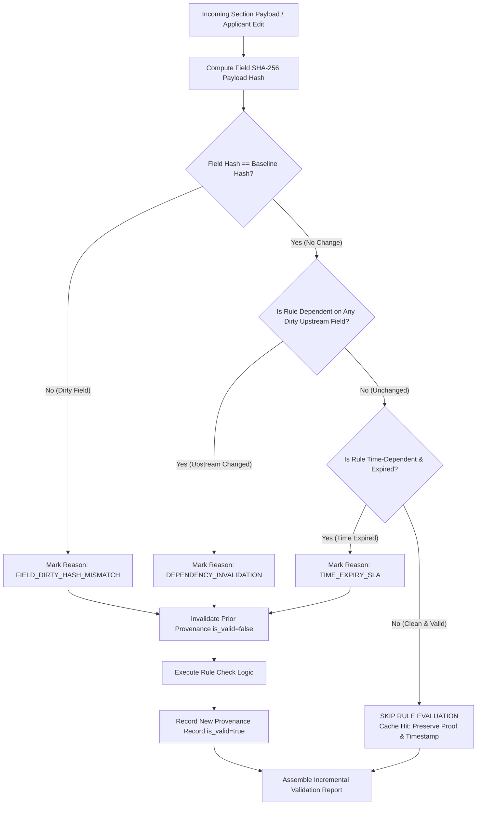

# AICTE Incremental Validation Engine & Change-Impact Analysis
## Platform: AICTE Approval & Compliance Orchestration Platform (SIH 26262)

**Document Version**: 1.0  
**Status**: Operational Specification  
**Compliance Standard**: AICTE Approval Process Handbook (APH 2026-27 Norms)

---

## 1. Executive Summary & Design Rationale

In traditional regulatory approval workflows, whenever an applicant amends a single field—such as fixing a typo in faculty designations or updating a single land survey number—the entire verification rule engine is rerun from scratch.

This naive approach introduces three critical failure modes:
1. **Loss of Certified Proofs**: Earlier human and automated verifications are wiped out, requiring re-scrutiny of hundreds of unaffected documents.
2. **Computational & I/O Overhead**: Rerunning complex geospatial, OCR, and cadre algorithms for thousands of colleges creates severe server bottlenecks.
3. **Audit Trail Disruption**: Statutory timestamps from original submissions are lost, undermining legal non-repudiation.

The **AICTE Incremental Validation Engine** eliminates blind re-runs through content-addressed SHA-256 payload hashing, dependency graph traversal, selective invalidation, and a persistent audit provenance ledger.

---

## 2. Architecture & Change-Impact Flow

---

## 3. Core Mechanics

### 3.1 Content Hashing & Field-Level Dirty Checks
Each data section or statutory document is digested into a cryptographic SHA-256 hash. When a re-evaluation request arrives:
- If `hash(incomingPayload) == activeProof.inputPayloadHash`, the field is marked **CLEAN**.
- If the hashes differ, the field is marked **DIRTY**, and its re-evaluation reason is set to `FIELD_DIRTY_HASH_MISMATCH`.

### 3.2 Dependency Graph Traversal
Rules frequently depend on fields outside their immediate section. The engine maps these interdependencies:
- Example 1: `RULE-BUILTUP-02` (Instructional & Administrative Area) directly inspects `builtup_area`, but its permissible Floor Area Ratio (FAR) depends on `land_details`. An edit to `land_details` automatically invalidates `RULE-BUILTUP-02` with reason `DEPENDENCY_INVALIDATION`, even if the building dimensions were untouched.
- Example 2: `student_intake` expansion automatically invalidates both `RULE-FACULTY-03` (cadre ratio) and `RULE-LABORATORY-06` (computing terminals). Unrelated rules like `RULE-LAND-01` are skipped.

### 3.3 Time-Dependent Expiration Rules
Certain statutory conditions deteriorate over time regardless of whether data was edited:
- Fire Safety NOC certificates (`RULE-FIRE-NOC-04`) and Building Stability certificates have statutory validity periods.
- If a certificate enters its expiration buffer or exceeds 30 days since evaluation, the engine forces a re-evaluation with reason `TIME_EXPIRY_SLA`.

### 3.4 Preservation of Unaffected Proofs (Cache Hits)
When a rule requires no re-evaluation:
- The rule logic execution is completely bypassed (0 ms processing delay).
- The existing `validation_provenance` entry remains active (`is_valid = true`).
- The original evaluation timestamp, officer name, and verification note are preserved for statutory auditing.
- The response increments `rulesSkippedCount`.

---

## 4. The Validation Provenance Table (`validation_provenance`)

Every decision, skip, and re-evaluation is committed to the PostgreSQL ledger:

| Column | Data Type | Description |
| :--- | :--- | :--- |
| `id` | `BIGINT` | Unique primary key. |
| `application_id` | `BIGINT` | Linked application reference. |
| `rule_id` | `VARCHAR(64)` | Canonical APH rule identifier (e.g. `RULE-LAND-01`). |
| `rule_name` | `VARCHAR(255)` | Human-readable rule title. |
| `aph_clause` | `VARCHAR(128)` | Official handbook citation (e.g. `APH 2026-27 Table 1.1 Norms`). |
| `rule_category` | `VARCHAR(32)` | `STATUTORY_MANDATORY` vs `ADVISORY_RECOMMENDED`. |
| `field_reference` | `VARCHAR(128)` | Directly referenced form field / section key. |
| `input_payload_hash` | `VARCHAR(64)` | SHA-256 cryptographic hash of the evaluated payload. |
| `validation_outcome` | `VARCHAR(32)` | `PASSED`, `FAILED`, or `WARNING`. |
| `decision_type` | `VARCHAR(32)` | `DETERMINISTIC_RULE` vs `AI_ASSISTED_ADVISORY`. |
| `re_evaluation_reason` | `VARCHAR(64)` | `INITIAL_EVALUATION`, `FIELD_DIRTY_HASH_MISMATCH`, `DEPENDENCY_INVALIDATION`, `TIME_EXPIRY_SLA`, or `SKIPPED_UNMODIFIED_CACHE_HIT`. |
| `evaluated_at` | `TIMESTAMPTZ` | Timestamp of evaluation. |
| `evaluated_by` | `VARCHAR(128)` | Officer username or `SYSTEM_VALIDATION_ENGINE`. |
| `execution_duration_ms` | `BIGINT` | Microsecond/millisecond performance benchmark. |
| `proofDetails` | `TEXT` | Detailed statutory reasoning and mathematical verification evidence. |
| `is_valid` | `BOOLEAN` | `true` for current active proof, `false` for superseded historical proofs. |

---

## 5. Canonical APH 2026-27 Rule Registry

| Rule ID | Rule Name | APH Handbook Source | Category | Decision Type | Dependent Fields |
| :--- | :--- | :--- | :--- | :--- | :--- |
| `RULE-LAND-01` | Minimum Contiguous Land Area & Title Ownership | APH 2026-27 Table 1.1 | `STATUTORY_MANDATORY` | `DETERMINISTIC_RULE` | `land_details`, `land_area`, `land_title_deed` |
| `RULE-BUILTUP-02` | Instructional & Administrative Built-up Area | APH 2026-27 Table 1.2 | `STATUTORY_MANDATORY` | `DETERMINISTIC_RULE` | `builtup_area`, `land_details`, `building_plan_approval` |
| `RULE-FACULTY-03` | Student-Faculty Cadre Ratio (1:15/1:20) & Strength | APH 2026-27 Table 2.1 | `STATUTORY_MANDATORY` | `DETERMINISTIC_RULE` | `faculty_roster`, `student_intake` |
| `RULE-FIRE-NOC-04` | State Fire Service Safety NOC Endorsement | APH 2026-27 Clause 3.4 | `STATUTORY_MANDATORY` | `DETERMINISTIC_RULE` | `fire_safety_noc`, `fire_safety_expiry_date` (Time-dependent) |
| `RULE-BUILDING-OCCUPANCY-05` | Occupancy / Completion Certificate from Authority | APH 2026-27 Clause 3.2 | `STATUTORY_MANDATORY` | `DETERMINISTIC_RULE` | `occupancy_certificate`, `builtup_area` |
| `RULE-LABORATORY-06` | Mandatory Laboratory Equipment & Terminal Counts | APH 2026-27 Clause 4.2 | `STATUTORY_MANDATORY` | `DETERMINISTIC_RULE` | `lab_infrastructure`, `student_intake` |
| `RULE-LIBRARY-07` | Library Titles, Volumes & Journal Subscriptions | APH 2026-27 Clause 4.5 | `ADVISORY_RECOMMENDED` | `DETERMINISTIC_RULE` | `library_resources` |
| `RULE-AI-READINESS-08` | Automated Scrutiny Risk Index & Deficiency Assessment | APH 2026-27 Appendix 6 | `ADVISORY_RECOMMENDED` | `AI_ASSISTED_ADVISORY` | `land_details`, `faculty_roster`, `lab_infrastructure`, `fire_safety_noc` |

---

## 6. Distinguishing Human Decisions from AI Recommendations

In compliance with **Phase 6 Rule & Workflow Safety Standards**:
- **Statutory Rules** are marked `DETERMINISTIC_RULE`. Failure to satisfy a statutory rule blocks scrutiny completion.
- **AI Recommendations** are marked `AI_ASSISTED_ADVISORY`.
- The system embeds an explicit disclaimer:
  > *"AI Automated Risk Index: Non-binding algorithmic assessment for officer guidance only; final approval decision rests solely with the authorized scrutiny officer."*
- An AI suggestion can never automatically approve or reject an application.
