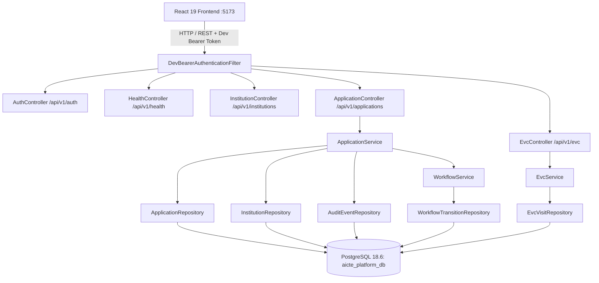

# AICTE Approval & Compliance Orchestration Platform (SIH 26262)
## Project Baseline Report (Phase 1)

**Document Version**: 1.0.0  
**Inspection Date**: 2026-10-26  
**Environment**: Linux x86_64, OpenJDK 21.0.11 LTS, Node.js v22.14.0, PostgreSQL 18.6  
**Repository Working Directory**: `/home/Harshit/Desktop/PROJECTS/SIH 2026/AICTE/SIH2 (Copy)`

---

## 1. Executive Summary

This baseline report captures the operational, structural, and architectural reality of the AICTE PS 26262 project following rigorous code inspection, test execution, database verification, and live API interrogation.

The project currently operates as a unified repository comprising:
1. **Spring Boot 3.4.3 Backend** (`src/main/java`, `pom.xml`) providing REST APIs for health, dev authentication, canonical institutions, approval applications, state-machine transitions, and Expert Visit Committee (EVC) operations.
2. **React 19 + Vite Frontend** (`frontend/`) providing role-tailored dashboards and operational modules for Institution Representatives, Scrutiny Officers, Regional Officers, EVC Coordinators, Compliance Reviewers, Senior Management, and Administrators.
3. **PostgreSQL 18.6 Database** managed via Flyway additive migrations (V1, V2, V3) holding live institutional records, applications, transitions, and EVC visits.

---

## 2. Environment & Service Execution Status

| Component | Target Port | Process / Container | Health Endpoint / Check | Verified Status |
| :--- | :--- | :--- | :--- | :--- |
| **PostgreSQL Database** | `5432` | `pg_ctl` (PID: 3771337) | `psql -h localhost -p 5432 -U aicte_app_user` | **PASS** (6 relational tables active) |
| **Spring Boot Backend** | `8080` | Java 21 (PID: 3792811) | `GET /api/v1/health` -> `{"status":"UP"}` | **PASS** (Stateless REST, HikariCP pool active) |
| **Vite React Frontend** | `5173` | Node 22 (PID: 3792904) | `GET http://localhost:5173` -> HTTP 200 OK | **PASS** (React 19, dev server active) |

---

## 3. Automated Test & Static Check Baseline

All tests were executed against active code paths. No simulated or skipped results are reported.

### 3.1 Backend Test Results (`./mvnw test`)
- **Execution Command**: `./mvnw test`
- **Result**: **PASS** (25 tests run, 0 failures, 0 errors, 0 skipped, Time: 10.10s)
- **Suite Breakdown**:
  - `HealthEndpointTest`: 2 tests passed (Health endpoint UP, Swagger redirect)
  - `PostgresPersistenceIntegrationTest`: 3 tests passed (Flyway migration verification, application entity persistence, audit event persistence)
  - `InstitutionAndApplicationApiIntegrationTest`: 9 tests passed (CRUD operations, pagination, duplicate prevention, optimistic locking)
  - `WorkflowAndSecurityIntegrationTest`: 5 tests passed (State transition rules, mandatory reason validation, timeline integrity)
  - `EvcOperationsIntegrationTest`: 6 tests passed (EVC scheduling, visit completion, report submission, rescheduling)

### 3.2 Frontend Test Results (`npm test`)
- **Execution Command**: `node tests/evcLifecycle.test.js`
- **Result**: **PASS** (6 of 6 tests passed)
- **Verified Behaviors**:
  - Baseline EVC test fixtures integrity
  - Scheduling lifecycle rules
  - Completion lifecycle guards and prerequisite checks
  - Tab filter partitioning rules
  - Report submission and advance to Committee review
  - Safe manual correction/revert paths

### 3.3 Frontend Production Bundle (`npm run build`)
- **Execution Command**: `npm run build` (Vite v8.3.5)
- **Result**: **PASS** (2,553 modules transformed, production assets generated in `frontend/dist/`)

### 3.4 Frontend Static Analysis (`npm run lint` - oxlint)
- **Execution Command**: `npm run lint` (oxlint v1.88.0)
- **Result**: **PASS with 0 errors** (110 unused variable/import warnings across 53 files, no syntax or structural bugs)

---

## 4. Architectural Baseline & Module Topology

---

## 5. Active Database Schema (Flyway Migrations V1 - V3)

1. **`institutions`** (Migration V1, extended in V2):
   - `id` (BIGINT GENERATED ALWAYS AS IDENTITY, PK)
   - `institutional_identifier` (VARCHAR 64, UNIQUE, e.g. `INST-1025`)
   - `name` (VARCHAR 255)
   - `region` (VARCHAR 64, e.g. `Northern Region`)
   - `created_at`, `updated_at` (TIMESTAMPTZ)
2. **`applications`** (Migration V1, extended in V2):
   - `id` (BIGINT GENERATED ALWAYS AS IDENTITY, PK)
   - `institution_id` (BIGINT, FK -> institutions.id)
   - `application_reference` (VARCHAR 64, UNIQUE, e.g. `APP-2026-1042`)
   - `application_type` (VARCHAR 64, e.g. `Extension of Approval (EoA)`)
   - `academic_year` (VARCHAR 16, e.g. `2026-2027`)
   - `status` (VARCHAR 32, e.g. `In progress`, `Due soon`, `Returned`, `Completed`)
   - `current_stage` (VARCHAR 64, e.g. `Scrutiny`, `Re-scrutiny`, `EVC scheduling`, `Committee review`)
   - `owner_name` (VARCHAR 128)
   - `owner_id` (VARCHAR 64)
   - `due_date` (DATE)
   - `observations` (TEXT)
   - `deficiencies_json` (TEXT)
   - `version` (BIGINT, Optimistic Locking)
   - `created_at`, `updated_at` (TIMESTAMPTZ)
3. **`audit_events`** (Migration V1):
   - `id` (BIGINT, PK)
   - `event_type` (VARCHAR 64)
   - `actor_id` (VARCHAR 128)
   - `target_entity_type` (VARCHAR 64)
   - `target_entity_id` (VARCHAR 64)
   - `metadata_json` (TEXT)
   - `created_at` (TIMESTAMPTZ)
4. **`workflow_transitions`** (Migration V2):
   - `id` (BIGINT, PK)
   - `application_id` (BIGINT, FK -> applications.id)
   - `action` (VARCHAR 64)
   - `from_stage`, `to_stage` (VARCHAR 64)
   - `from_status`, `to_status` (VARCHAR 32)
   - `actor_id`, `actor_name`, `actor_role`
   - `reason`, `observations`, `deficiencies_json`
   - `created_at` (TIMESTAMPTZ)
5. **`evc_visits`** (Migration V3):
   - `id` (BIGINT, PK)
   - `application_id` (BIGINT, FK -> applications.id, UNIQUE)
   - `evc_reference` (VARCHAR 64, UNIQUE)
   - `status` (VARCHAR 32, `Awaiting scheduling`, `Scheduled`, `Completed`, `Cancelled`)
   - `urgency` (VARCHAR 32)
   - `inspection_type` (VARCHAR 64)
   - `coordinator_name`, `coordinator_id`
   - `visit_date`, `deadline` (DATE)
   - `experts_json` (TEXT)
   - `report_status`, `report_outcome`, `report_notes`, `completion_notes`
   - `version` (BIGINT, Optimistic Locking)
   - `created_at`, `updated_at` (TIMESTAMPTZ)
6. **`flyway_schema_history`**: Tracks migrations V1, V2, V3.

---

## 6. Disconnected & Missing Components Summary

1. **Documents Registry & Durable Storage**: Not implemented in backend. No SQL table, no storage abstraction on disk, no hash verification or versioning. Frontend `DocumentsPage` uses in-memory React state with simulated uploads.
2. **Compliance Obligations & Verifications**: Not implemented in backend. No SQL table. Frontend `CompliancePage` displays empty state or in-memory array.
3. **Alerts & Deadlines**: Not implemented in backend. No SQL table or reminder service. Frontend `AlertsPage` uses in-memory state.
4. **Role & Record Authorization**: Spring Security authenticates requests via `DevBearerAuthenticationFilter` but does not enforce tenant scoping, regional isolation, or role-based authorization rules on endpoints.
5. **Incremental Validation Engine**: Missing. No OCR/hash provenance table, change-impact graph, or dependency-level comparison algorithm.
6. **Deficiency Resolution Semantics**: Currently, `SUBMIT_CORRECTIONS` in `WorkflowService` clears the `deficiencies_json` field automatically upon institution upload, violating the mandate that deficiencies remain separate and can only be resolved by authorized re-scrutiny officers.
