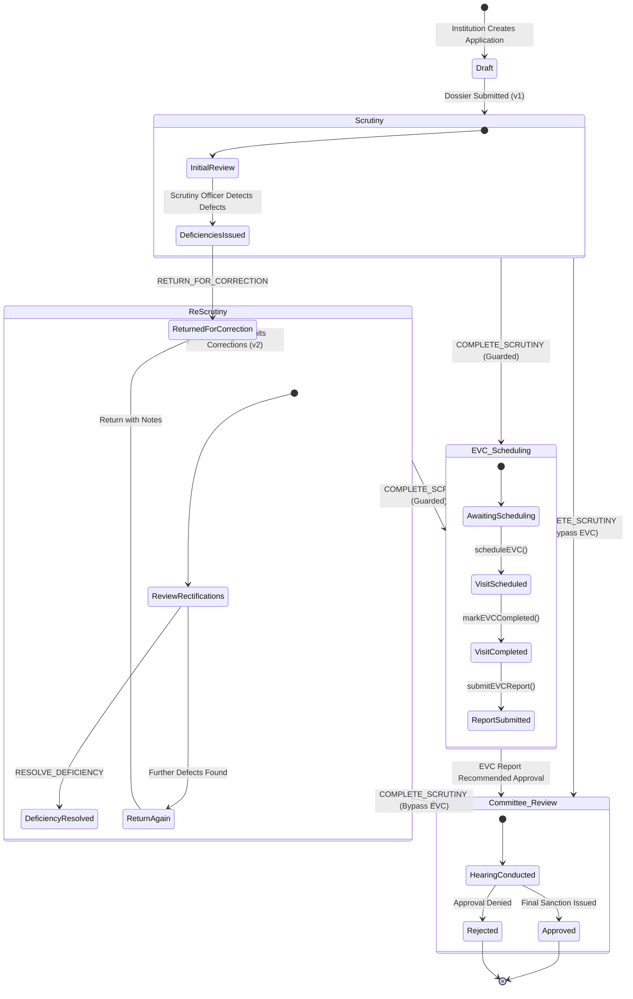

# AICTE Approval Workflow & Role-Based Permissions Reference
## Platform: AICTE Approval & Compliance Orchestration Platform (SIH 26262)

**Document Version**: 2.0  
**Status**: Active Production Standard  
**Compliance Standard**: AICTE Approval Process Handbook (APH 2026-27 Norms)

---

## 1. Canonical AICTE Roles (11 Roles)

The platform enforces strict role-based access control (RBAC) across 11 canonical institutional and bureaucratic roles:

| Role Identifier | Role Display Name | Primary Responsibilities & Functional Scope |
| :--- | :--- | :--- |
| `ROLE_INSTITUTION_REPRESENTATIVE` | Institution Representative | Prepares applications, uploads statutory certificates, submits deficiency corrections, and views institutional obligations. Strictly isolated to their own college (`institutionalIdentifier`). |
| `ROLE_REGIONAL_OFFICER` | Regional Officer | Manages regional intake, oversees scrutiny workflows, reviews regional escalations, and assigns territorial tasks. Strictly isolated to their assigned geographic region (`region`). |
| `ROLE_SCRUTINY_OFFICER` | Scrutiny Officer | Performs technical document verification, toggles statutory checklist items, issues itemized deficiencies, and completes technical scrutiny. |
| `ROLE_EVC_COORDINATOR` | EVC Operations Coordinator | Schedules Expert Visit Committee (EVC) on-site visits, assigns certified peer experts, monitors visit deadlines, and records inspection completion. |
| `ROLE_EVC_EXPERT` | EVC Peer Expert | Conducts physical or virtual infrastructure inspections and uploads peer inspection findings and photographic evidence. |
| `ROLE_COMPLIANCE_REVIEWER` | Compliance Reviewer | Audits post-approval undertakings, verifies statutory compliance evidence, reviews document renewals, and records compliance decisions. |
| `ROLE_COMMITTEE_MEMBER` | Standing Hearing Committee Member | Reviews contested or deficiency-burdened applications, conducts official hearing proceedings, and votes on approval recommendations. |
| `ROLE_LEGAL_OFFICER` | Legal Cell Officer | Evaluates court cases, land encumbrance challenges, trust deed disputes, and statutory legal undertakings. |
| `ROLE_SENIOR_MANAGEMENT` | Senior Management / Competent Authority | Executive oversight (Member Secretary / Chairman), high-level SLA dashboards, policy exception overrides, and final approval issuance. |
| `ROLE_ADMINISTRATOR` | System Administrator | Platform configuration, master institution registry maintenance, role assignment, and technical system health monitoring. Multi-tenant bypass allowed for system maintenance. |
| `ROLE_AUDITOR` | Process & Quality Auditor | Read-only regulatory auditing, inspection of provenance ledgers, workflow transition logs, and SLA turnaround reports. |

---

## 2. Multi-Tenant Scoping & Territorial Regional Isolation

Every request passing through the platform is intercepted and evaluated against two structural security perimeters in `SecurityUtils.java`:

### 2.1 Institutional Multi-Tenant Isolation
- **Rule**: Users with `ROLE_INSTITUTION_REPRESENTATIVE` can ONLY view or execute actions on records belonging to their assigned institution.
- **Enforcement**:
  ```java
  if (user.role() == ROLE_INSTITUTION_REPRESENTATIVE) {
      if (!institution.getInstitutionalIdentifier().equalsIgnoreCase(user.institutionId())) {
          throw new AccessDeniedException("Access Denied: You are not authorized to view or act upon records for institution " + institution.getInstitutionalIdentifier());
      }
  }
  ```
- **Auto-Scoping**: List queries (`GET /api/v1/applications`, `GET /api/v1/compliance`, `GET /api/v1/documents`) automatically filter results by the caller's `institutionId`. Cross-tenant URL tampering (e.g., passing another college's ID in request headers or path) is intercepted and returns **HTTP 403 Forbidden**.

### 2.2 Territorial Regional Isolation
- **Rule**: Users with `ROLE_REGIONAL_OFFICER` are strictly restricted to institutions, applications, and EVC visits located in their assigned geographic jurisdiction (e.g. `Northern Region`, `Western Region`, `Southern Region`).
- **Enforcement**:
  ```java
  if (user.role() == ROLE_REGIONAL_OFFICER) {
      if (!targetRegion.equalsIgnoreCase(user.region())) {
          throw new AccessDeniedException("Access Denied: Regional Officer from " + user.region() + " cannot access records in " + targetRegion);
      }
  }
  ```

---

## 3. Workflow State Machine & Lifecycle Transitions



---

## 4. Itemized Deficiency Resolution Loop

Earlier prototypes suffered from a critical workflow flaw where resubmitting an application wiped out previous deficiencies. The platform resolves this with a decoupled, itemized state machine:

### 4.1 Deficiency Lifecycle States
1. `OPEN`: Deficiency recorded by Scrutiny Officer with specific APH handbook requirement reference (e.g. `APH Table 2.1 Norms`).
2. `RECTIFIED_PENDING_REVIEW`: Institution submits a formal rectification package (`SUBMIT_CORRECTIONS`). The institution response is attached to each item, but the deficiency remains **unresolved** pending scrutiny review.
3. `RESOLVED`: Scrutiny Officer explicitly reviews the evidence and records an officer resolution note (`RESOLVE_DEFICIENCY`). Only this action transitions the item to `RESOLVED`.

### 4.2 The Scrutiny Completion Guard
To guarantee regulatory integrity, the platform enforces an unbypassable completion guard in `WorkflowService.java`:
```java
long openOrPendingDeficiencies = deficiencyRepository.countByApplicationIdAndStatusIn(
        application.getId(),
        List.of("OPEN", "RECTIFIED_PENDING_REVIEW")
);
if (openOrPendingDeficiencies > 0) {
    throw new IllegalArgumentException(
            "Cannot complete scrutiny: " + openOrPendingDeficiencies + 
            " statutory deficiency items remain unresolved. All deficiencies must be resolved prior to advancing."
    );
}
```
Attempting to complete scrutiny with open deficiencies triggers an RFC 7807 Bad Request error.

---

## 5. Action-Level Role Permission Matrix

| Workflow Action | Endpoint | Permitted Roles | Scoping Constraint |
| :--- | :--- | :--- | :--- |
| `CREATE_APPLICATION` | `POST /applications` | `INSTITUTION_REPRESENTATIVE`, `ADMINISTRATOR` | Current institution only |
| `RETURN_FOR_CORRECTION` | `POST /applications/{id}/actions` | `SCRUTINY_OFFICER`, `REGIONAL_OFFICER`, `ADMINISTRATOR` | Regional match |
| `SUBMIT_CORRECTIONS` | `POST /applications/{id}/actions` | `INSTITUTION_REPRESENTATIVE`, `ADMINISTRATOR` | Owner institution only |
| `RESOLVE_DEFICIENCY` | `POST /applications/{id}/actions` | `SCRUTINY_OFFICER`, `REGIONAL_OFFICER`, `ADMINISTRATOR` | Regional match |
| `COMPLETE_SCRUTINY` | `POST /applications/{id}/actions` | `SCRUTINY_OFFICER`, `REGIONAL_OFFICER`, `ADMINISTRATOR` | Guarded (0 open defects) |
| `SCHEDULE_EVC` | `POST /evc/{id}/schedule` | `EVC_COORDINATOR`, `REGIONAL_OFFICER`, `ADMINISTRATOR` | Regional match |
| `COMPLETE_EVC` | `POST /evc/{id}/complete` | `EVC_COORDINATOR`, `EVC_EXPERT`, `ADMINISTRATOR` | Assigned inspection |
| `SUBMIT_EVC_REPORT` | `POST /evc/{id}/report` | `EVC_COORDINATOR`, `EVC_EXPERT`, `ADMINISTRATOR` | Advances to Committee |
| `SUBMIT_COMPLIANCE` | `POST /compliance/{id}/submit` | `INSTITUTION_REPRESENTATIVE`, `ADMINISTRATOR` | Owner institution only |
| `VERIFY_COMPLIANCE` | `POST /compliance/{id}/verify` | `COMPLIANCE_REVIEWER`, `REGIONAL_OFFICER`, `ADMINISTRATOR` | Regional match |
| `UPLOAD_DOCUMENT` | `POST /documents/upload` | `INSTITUTION_REPRESENTATIVE`, `ADMINISTRATOR` | Computes SHA-256 |
| `RENEW_DOCUMENT` | `POST /documents/{id}/renew` | `INSTITUTION_REPRESENTATIVE`, `ADMINISTRATOR` | Creates version ledger |
| `VERIFY_DOCUMENT` | `POST /documents/{id}/verify` | `COMPLIANCE_REVIEWER`, `REGIONAL_OFFICER`, `ADMINISTRATOR` | Sealed verification |
| `ACKNOWLEDGE_ALERT` | `POST /alerts/{id}/acknowledge` | Any authenticated user assigned | Recipient match |
| `ESCALATE_ALERT` | `POST /alerts/{id}/escalate` | `REGIONAL_OFFICER`, `SENIOR_MANAGEMENT`, `ADMINISTRATOR` | Escalates SLA tier |
| `INCREMENTAL_EVALUATE` | `POST /validation/{id}/evaluate` | `INSTITUTION_REPRESENTATIVE`, `SCRUTINY_OFFICER`, `REGIONAL_OFFICER`, `COMPLIANCE_REVIEWER`, `SENIOR_MANAGEMENT`, `ADMINISTRATOR` | Regional / Tenant match |
